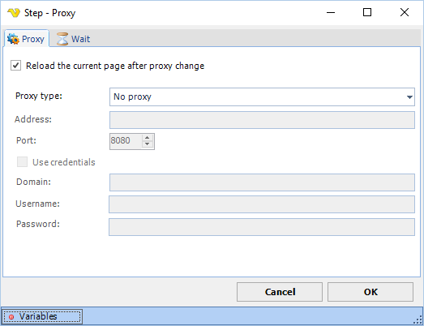

## Proxy Step

The Proxy action of the [Task Net - Web Macro](web-macro) changes the proxy while the macro runs. It overrides the proxy set earlier, on the Task's ***Proxy*** tab or by an earlier Proxy action. The action window is titled _Action - Proxy_. To add it while recording, click _Add Proxy_ on the toolbar of the _Web recorder_ window.

### Proxy tab

- _Reload the current page after proxy change_: selected by default; when selected, the current page is reloaded after the proxy changes

- _Proxy type_: "No proxy" (default), "HTTP Proxy", "SOCKS4" or "SOCKS5"; with "No proxy", all other proxy fields are turned off

  To stop using a proxy part way through the macro, add a Proxy action with "No proxy".

- _Address_: the proxy server address, active when _Proxy type_ is not "No proxy"; a new action shows a sample address, so replace it
- _Port_: the proxy server port, as a whole number, active when _Proxy type_ is not "No proxy"; a new action shows a sample port, so replace it

Unlike the Task's ***Proxy*** tab, the action does not check these fields when you click _OK_. Make sure _Address_ and _Port_ are filled in.

- _Test url_: a URL used to test the proxy, active when _Proxy type_ is not "No proxy"

  Click _Test_ to request the URL through the proxy. The test passes only when the URL returns HTTP status 200.

:::warning

The test runs from the computer running the Client, not from the Server, and it accepts any server certificate without checking it. A passed test does not show that the Server can reach the proxy, or that the site's certificate is valid.

:::

- _Authentication_: the HTTP authentication method, "Basic" (default), "Digest", "NTLM" or "Not set"; active only when _Proxy type_ is "HTTP Proxy"
- _Use credentials_: cleared by default; when selected, the _Domain_, _Username_ and _Password_ fields are turned on for proxy authentication; active when _Proxy type_ is not "No proxy"
- _Domain_: the domain for proxy authentication, active when _Use credentials_ is selected
- _Username_: the user name for proxy authentication, active when _Use credentials_ is selected
- _Password_: the password for proxy authentication, active when _Use credentials_ is selected
- _Use proxy for data channel_: cleared by default; when selected, routes the data channel through the proxy; shown only when _Proxy type_ is not "No proxy"

### Wait tab

Sets how long the action waits before it runs (_Wait before execute_) and after it runs (_Wait after execute_), in milliseconds. Both are "500" by default.
