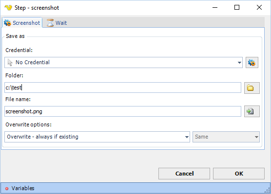

## Screenshot Step

The Screenshot action of the [Task Net - Web Macro](web-macro) takes a screenshot of the browser and saves it to a file. The action window is titled _Action - Screenshot_.

### Screenshot tab

The _Save as_ group holds the following settings:

- _Credential_: if the folder is on a network resource, the Credential with access to it; see [Global - Credentials](../../global-credentials)
- _Folder_: the folder where the screenshot is saved; to select a folder, click the folder icon

  When the Task runs, the Server saves the file, so use a folder that exists on the Server. During _Test run_, the file is saved on the computer running the Client.

- _File name_: the file name to save the screenshot as; to select an existing file name, click the file icon

The action window does not check _Folder_ and _File name_ when you click _OK_. Make sure both are filled in.

- _Overwrite options_: what happens when a file with the same name already exists in the folder
  - "Overwrite - always if existing" (default): the existing file is replaced
  - "Overwrite - if destination size is": the existing file is replaced when its size matches the condition in the list next to _Overwrite options_
  - "Do not overwrite if existing": the file is not saved if one with the same name exists
- The list next to _Overwrite options_: the size condition, active only with "Overwrite - if destination size is"; "Same", "Smaller" (default), "Larger", "Smaller or larger" or "Different"
- _Screenshot type_: what is captured; "Window" (default) captures the visible part of the page, and "Page" captures the full page
- _Screenshot size_: "Full" (default) captures the whole area set by _Screenshot type_, and "Part" captures the rectangle set in _Relative position and size of rectangle_
- _Relative position and size of rectangle_: active only when _Screenshot size_ is "Part"

  Enter _X_ and _Y_ for the top-left corner of the rectangle, and its _Width_ and _Height_, in pixels. All four must be whole numbers.

:::warning

By default, an existing file with the same name is replaced.

:::

### Wait tab

Sets how long the action waits before it runs (_Wait before execute_) and after it runs (_Wait after execute_), in milliseconds. Both are "500" by default.
