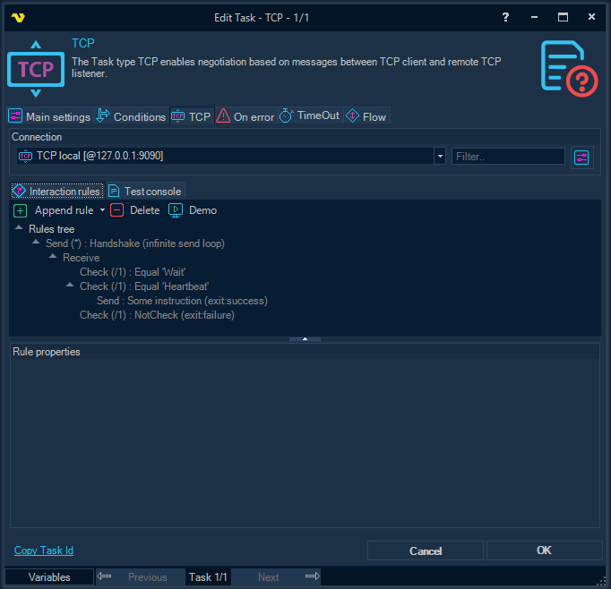
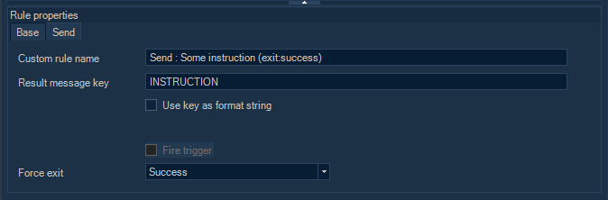
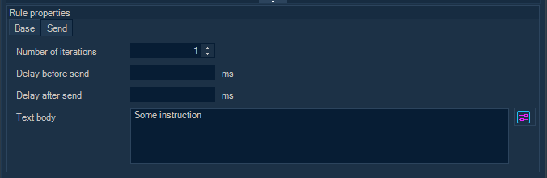
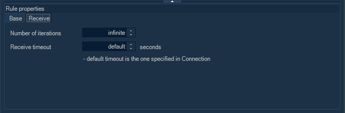
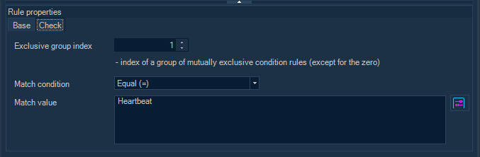
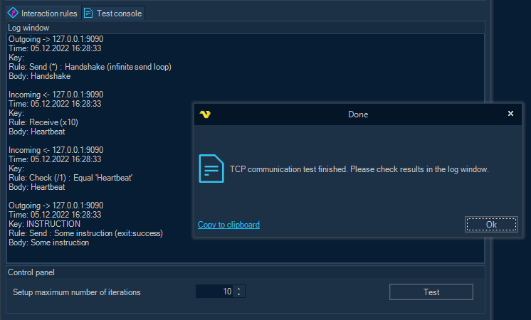

## Task Net - TCP

The TCP Task connects to a TCP server (listener) as a client and exchanges plain-text messages with it, following a tree of messaging rules: what to send, what to wait for, and what to check in a reply.

This Task uses a TCP Connection; see [Connection - TCP](../../connection-tcp). In the Connection, enter only a host name or an IPv4 address in _Address_: the Client splits the text at each ":", "/" or "\\" and keeps one part, so an IPv6 address, a port or a path there does not work.

:::warning

The messages are sent and received as plain text, without encryption, so anyone who can see the network traffic can read them.

:::

The ***Main settings***, ***Flow***, ***On error***, ***Conditions*** and ***TimeOut*** tabs are the same for every Task; see [Job - Tasks](../../job-tasks).

### Interaction rules tab



Select the TCP Connection with the server's address and port in the _Connection_ group.

The tab holds the tree of rules that controls the exchange (see [TCP messaging rules](#tcp-messaging-rules)). The toolbar has these commands:

- _Append rule_: adds a child rule to the selected rule: "Send", "Receive" or "Check"
- _Delete_: deletes the selected rule and all its child rules
- _Demo_: replaces the current rules with an example of a simple exchange between a client and a server

  If the tree has rules, the Client asks before it deletes them.
 
#### TCP messaging rules

Messaging rules set up the exchange between the TCP server (listener) and the TCP client. The TCP Task and the [Event Trigger - TCP](../../event-trigger-tcp) use the same rules. The only difference is _Fire trigger_, which only the Trigger uses.

There are three types of rule:

- _Send_: sends a message
- _Receive_: waits for a message
- _Check_: checks the message of its parent rule

The rules form a tree, so that the exchange can take different paths depending on the content of a message. The rules at one level run in order. A rule runs its child rules before the next rule at its own level. Select a rule to set its properties in _Rule properties_.



The ***Base*** subtab, for every rule:

- _Custom rule name_: optional, stored encrypted

  Without a name, the rule gets a generated name.

- _Result message key_: optional. When it is set, the message of the rule is added to the result list under this key

  For each key, only the last message is kept.

- _Use key as format string_: uses _Result message key_ as a number format for a message counter, so that each message gets its own key

  For example, "D2" gives the keys "01", "02" and so on.

- _Fire trigger_: TCP Trigger only. Fires the Trigger with the current message, and then clears the result list
- _Force exit_: whether the exchange stops and the connection closes after this rule and its child rules:
  - blank (default): no forced exit; the exchange continues
  - "Success": ends the exchange as successful
  - "Failure": ends the exchange with an error, so the Task fails

_Force exit_ is useful to end rules that repeat without limit.



The ***Send*** subtab:

- _Number of iterations_: how many times the rule and its child rules run before the next rule at the same level

  "1" by default. "0" skips the rule, and "-1" repeats it without limit.

- _Text body_: the message to send, stored encrypted. It can contain Variables
- _Delay before send_: optional wait before the message is sent, in milliseconds
- _Delay after send_: optional wait after the message is sent, in milliseconds



The ***Receive*** subtab:

- _Number of iterations_: as on ***Send***
- _Receive timeout_: how long, in seconds, to wait for a message

  "-1" (default) uses the _Timeout_ of the TCP Connection, or "30" seconds when that is "0". "0" waits for a message without a time limit. If the server closes the connection before a message arrives, the rule fails.



The ***Check*** subtab:

- _Exclusive group index_: optional. Groups Check rules that are children of the same rule

  Check rules that are children of the same rule and have the same index other than "0" form a group: once one of them matches, the others are skipped.

- _Match condition_: how the message of the parent rule is compared with _Match value_

  The values are "Don't check" (default; always matches), "Equal (=)", "Contains (=%)", "Not contains (!=%)", "Not equal (!=)", "Regex - match" and "Regex - no match". The comparisons are case sensitive.

- _Match value_: the value to compare with, stored encrypted. It can contain Variables

:::warning

When a Check rule does not match, its child rules are skipped, and the Task still succeeds. A reply that matches no Check therefore does not make the Task fail. To fail on an unexpected reply, add a Check that matches it, with _Force exit_ set to "Failure".

:::
 
### Test console tab



Use the ***Test console*** tab to try the rules without saving the Task. The test runs on the VisualCron Server with the selected Connection, and the messages are shown in the _Log window_. As the server side of the test, you can run a similar test in the [Event Trigger - TCP](../../event-trigger-tcp) window, or build and run the sample listener below.

- _Setup maximum number of iterations_: for the test only, rules with more iterations, or with "-1", run at most this many times

  The default is "10", from "1" to "999".

- _Test_: runs the test

:::note

The limit applies only to the test. When the Task runs, a rule with "-1" iterations repeats until a rule with _Force exit_ ends the exchange, the connection closes, or the Task times out (see [Task - Timeout](../../task-timeout)).

:::

### Output and result

Only the messages of rules with a _Result message key_ are written to the output of the Task, and only when the TCP Connection has _Log sent messages to task output_ or _Log received messages to task output_ selected. A rule without a key is not logged.

The Task has one result Variable:

- _Messages_: the list of result messages, as `{ Key, TextBody }` pairs, so that a Variable can read the text of a message by its _Result message key_

### Sample TCP listener (C#)

```csharp

using System.Net;
using System.Net.Sockets;
using System.Text;
 
namespace TCP_Listener
{
  internal class Program
   {
      static void Main()
       {
           TcpListener tcpListener = null;
          try
           {
              /*
                * Start listening
                */
               Console.WriteLine("Starting listener .....");
               tcpListener = new TcpListener(new IPEndPoint(IPAddress.Parse("127.0.0.1"), 9090));
               tcpListener.Start();
               Console.WriteLine("Listener started");
 
              /*
                * Wait for TCP client
                */
               Console.WriteLine("Waiting for connection .....");
              using var tcpclnt = tcpListener.AcceptTcpClient();
              using var stm = tcpclnt.GetStream();
               Console.WriteLine("Client connected");
 
              /*
                * WARNING:
                *   the encoding should be the same as configured in the TCP Connection / Common settings / Code page
                */
              var enc = Encoding.UTF8;
              string message;
              byte[] buffer;
 
              /*
                * Receiving an initial handshake message
                */
               Console.WriteLine();
               Console.WriteLine("Receiving an initial message .....");
               Thread.Sleep(1000);
 
               buffer = new byte[tcpclnt.ReceiveBufferSize];
              var cnt = stm.Read(buffer, 0, buffer.Length);
 
               message = enc.GetString(buffer, 0, cnt);
               Console.WriteLine("Message received : " + message);
 
              /*
                * Checking the handshake message
                */
              const string handshake_request = "Handshake";
              if (message == handshake_request)
               {
                   Console.WriteLine("Handshake request checked.");
                   Thread.Sleep(1000);
               }
              else
               {
                   Console.WriteLine($"The request is invalid. Must be '{handshake_request}'");
                  return;
               }
 
              /*
                * Sending "Heartbeat"
                */
               message = "Heartbeat";
               Console.WriteLine();
               Console.WriteLine($"Sending '{message}' .....");
               buffer = enc.GetBytes(message);
               stm.Write(buffer, 0, buffer.Length);
 
               Console.WriteLine($"'{message}' sent");
               Thread.Sleep(1000);
 
              /*
                * Receiving some instruction
                */
               Console.WriteLine();
               Console.WriteLine("Receiving an instruction .....");
               buffer = new byte[tcpclnt.ReceiveBufferSize];
               cnt = stm.Read(buffer, 0, buffer.Length);
 
               message = enc.GetString(buffer, 0, cnt);
               Console.WriteLine("Instruction received : " + message);
           }
          finally
           {
               tcpListener?.Stop();
               Console.WriteLine("Exit.");
           }
       }
   }
}

```
