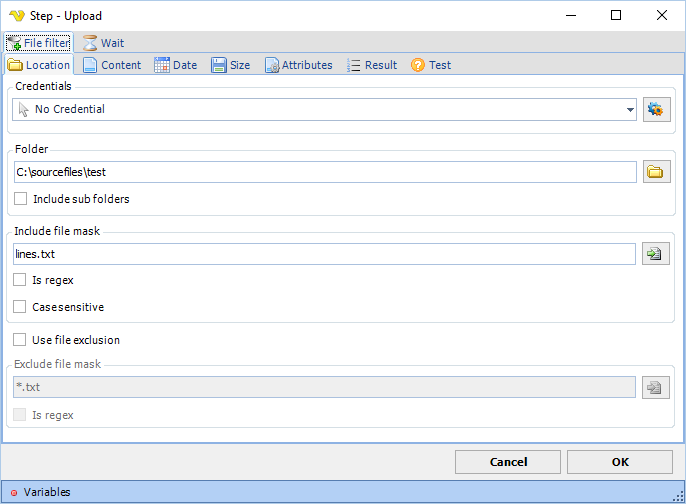

## Upload Step

The Upload action of the [Task Net - Web Macro](web-macro) uploads one or more files as part of a web macro. The action is created automatically when a file upload is recorded, and you can edit it afterward to make the file selection more dynamic. The action window is titled _Action - Upload_.

### File filter tab

Selects the files to upload, with the standard VisualCron file filter; see [File Filter](../../job-tasks-file-filter). When the Task runs, the files are found on the Server. During _Test run_, they are found on the computer running the Client.

### Wait tab

Sets how long the action waits before it runs (_Wait before execute_) and after it runs (_Wait after execute_), in milliseconds. Both are "500" by default.
