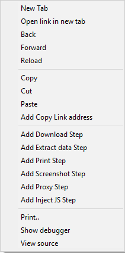

## Task Net - Web Macro

The Web Macro Task records actions in a built-in browser and plays them back later, in the background, at any time.

The ***Main settings***, ***Flow***, ***On error***, ***Conditions*** and ***TimeOut*** tabs are the same for every Task; see [Job - Tasks](../../job-tasks).

Features of the Web Macro Task:

- Playback uses a browser based on the Chromium engine, for speed and compatibility
- Plugins are supported; see the ***Plugins*** tab below
- Playback runs in the VisualCron Server service and needs no interaction, so no one has to be logged on
- Several web macros can run at the same time, and you can keep working on the computer during playback
- Passwords and keys entered in the Task, such as the Google API key, the Google Client secret and the proxy password, are stored encrypted; cookies kept with _Store cookies_ are not (see _Store cookies_ below)
- File filters, Variables and stored Credentials can supply values at run time, such as dates
- The Task can handle several browser tabs at the same time, and copy and paste data between them
- Popup windows open in a new tab
- Files can be uploaded and downloaded, and file filters can select the files to upload
- The proxy can be changed at any point in the macro
- Client certificates can be imported, and are presented when a server asks for one
- Tabs can be opened in Incognito mode
- Pages can be printed and saved as screenshots
- You can set the User-Agent, the HTTP referer and the Accept-Language that the browser sends
- JavaScript can be injected into a page
- Google API keys can be set, for Google features such as speech recognition
- You control the playback speed, from typing text to the wait before and after each action
 
### Web macro: Main settings tab

The Web Macro settings have their own tabs inside the Task window: ***Main settings***, ***Actions***, ***Proxy***, ***Certificates*** and ***Plugins***. This ***Main settings*** tab is not the Task window's shared ***Main settings*** tab.

The _Browser options_ group holds the following settings:

- _Load images_: selected by default; clearing it makes pages load faster, but keep it selected if the macro depends on images
- _Block popups_: when cleared, a popup that a page opens in a new window opens in a new tab instead; select it to stop this
- _Lite mode_: turns off rectangle selection and other JavaScript-intensive actions while recording
- _Disable WebSecurity_: selected by default; see the warning below
- _Override User-Agent_: when selected, the browser sends the User-Agent in the text field instead of the one for its own Chromium version
- _Store cookies_: when selected, the Task keeps the cookies from one recording and uses them in the next; see the warning below

  This helps when a site asks security questions the first time you log on: select _Store cookies_, record once while answering the questions, then record again. The cookies from the first recording are still present. When you clear _Store cookies_ and save the Task, the stored cookies are deleted.

- _Pass cookies between Tasks in Job session_: shares cookies with the other HTTP and Web Macro Tasks of the same Job run, to keep sessions open

  When this Task succeeds, it adds its cookies to the cookie store of the Job run. Later HTTP Tasks in the same run send them, and later Web Macro Tasks use them if they also have this setting selected. With this setting selected, the Task also receives the cookies that earlier HTTP and Web Macro Tasks of the run left in the store. For the HTTP Task, see [Task Net - HTTP](http).

- _Constantly update previews_: selected by default; when selected, the action preview images are updated after a recording or test run
- _Extended variables_: cleared by default; when selected, the Job Variables and User Variables are loaded into the action designer on the ***Actions*** tab
- _Maximize window on test/record_: selected by default; when selected, the recorder window opens maximized when you click _Record_ or _Test run_
- _Override referer_: when selected, the browser sends the referer in the text field instead of the last page visited; the field holds a sample value until you change it
- _Accept-Language_: the Accept-Language that the browser sends, "en-US" by default

  Some sites return different content for different languages, for example in date and time formats or in the page language.

:::warning

_Disable WebSecurity_ is selected by default. While it is selected, the browser does not enforce the [same-origin policy](https://en.wikipedia.org/wiki/Same-origin_policy), so a page in the Task's browser can read data from other sites that the same session is signed in to. Clear it unless playback fails without it; see [Troubleshooting](#troubleshooting).

:::

:::warning

With _Store cookies_ selected, the site's cookies, including session and logon cookies, are saved with the Task as text. Unlike passwords, they are not encrypted, so anyone who can read or export the Task can reuse the session. Clear _Store cookies_ when the macro no longer needs it.

:::
 
The _Google API_ group holds the Google keys. Some browser features rely on Google APIs. For example, location relies on Google's geolocation API, and speech recognition relies on Google's Speech API. To use these features, get Google API keys and enter them in this group:

- _GoogleClientID_: your Google Client ID
- _GoogleAPIKey_: your Google API key, stored encrypted
- _GoogleClientSecret_: your Google Client secret, stored encrypted

To get a Google API key, complete the following steps. Google changes its console often, so the labels can differ.

1. Go to `https://console.developers.google.com/`.
2. Sign in with a Google account.
3. Create a project, or select an existing one.
4. Enable the API that the feature needs, for example the Speech API.
5. Open _Credentials_.
6. Create an API key.

The new key appears in the console. Enter it in _GoogleAPIKey_.
 
### Recording a web macro

Click _Record_ to start recording. The _Web recorder_ window opens; see [Web recorder window](#web-recorder-window).

### Playing back a web macro

A web macro can be played back in both the Client and the Server. Click _Test run_ to play it back in the Client.

_Test run_ runs the actions on the computer running the Client. Files are then found and saved on that computer, and Credentials are applied there. When the Task runs from a Job, the Server does this instead. A folder, file or Credential that works in a test run can therefore fail when the Task runs on the Server, or the reverse.
 
### Web macro: Actions tab

The ***Actions*** tab shows the Task's actions in a workflow designer. Actions are created automatically while you record. You can also add some actions manually in the _Web recorder_ window; see [Web recorder window](#web-recorder-window).

If the workflow has errors, an errors panel opens on the tab. Until the errors are fixed, the Task cannot be saved and _Test run_ is unavailable.

Each action waits before it runs and after it runs, in milliseconds (_Wait before execute_ and _Wait after execute_, "500" each by default). To set both values on every action at once, click _Set wait for all actions_. The button shows only on the ***Actions*** tab.
 
### Web macro: Proxy tab

The ***Proxy*** tab sets the default proxy for all browser tabs. To change the proxy part way through the macro, add a Proxy action; see [Proxy Step](proxy-step). The proxy fields are the same as on the Proxy action, except _Reload the current page after proxy change_, which only the action has.

When _Proxy type_ is not "No proxy", _Address_ and _Port_ are required, and _Port_ must be a whole number. With _Use credentials_ selected, _Username_ and _Password_ are also required. These fields are checked when you save the Task and when you click _Record_ or _Test run_.
 
### Web macro: Certificates tab

The Web Macro Task can present a client certificate to a remote server when the server asks for one. Client certificates are managed globally; see [Global - Certificates](../../global-certificates). To open the global list, click _Manage Certificates_. In the _Certificates_ list, select _Use_ for the certificate to present. One certificate can be used at a time.

If the selected certificate is later removed from the global certificates, the Task fails when it runs.

:::warning

_Auto-accept all server certificates_ has no effect: the Task always runs with server certificates auto-accepted, whether or not the box is selected. Use the Task only with sites you trust, and do not rely on it to detect an invalid or replaced server certificate.

:::
 
### Web macro: Plugins tab

The Web Macro browser does not support NPAPI plugins.

:::note

The Web Macro browser (Chromium based) does not support Flash, which reached end of life in 2020.

:::

- _Allow plugins_: selected by default; when selected, plugins are enabled and the _Plugin settings_ group becomes active, and when cleared, all plugin support is off

The _Plugin settings_ group holds the following settings:

- _Disable built in plugins_: cleared by default; when selected, the built-in PDF plugin is not loaded
- _Additional plugin folders (separate by semicolon)_: the folders of plugins that are located elsewhere, separated by semicolons
 
### Output tab

The Task window adds an ***Output*** tab for this Task type. It is not one of the Web macro tabs above. It controls the recording of the playback that the Task adds to its output, which the Server builds from the screenshots taken during playback. To view the output of a run, see [Task - Output and Result](../../task-output-and-result).

The _Output settings_ group holds the following settings:

- _Output type_: "None", "Images", "GIF" (default) or "Video"; "None" turns off all other settings on the tab
- _Frame rate_: frames per second, from "1" to "60", "1" by default; not used with "Images"
- _Quality_: from "1" to "100", "75" by default; used only with "Images" when _Image format_ is "JPEG"
- _Image format_: "BMP", "JPEG", "GIF", "PNG" (default) or "TIFF"; used only with "Images"
- _Open settings_: opens the video compression settings; used only with "Video"
- _Save output to file_: cleared by default; when selected, the output is also saved to a file, set in the _File output settings_ group, and when cleared, it is kept only in the Task output

:::note

Because "GIF" is the default, each run stores a recording of the browser screens in the Task output. Users who can view the Task output can see what the pages showed. If the pages show data that should not be kept, select "None".

:::

The _File output settings_ group holds the following settings. _Output folder_ and _File name_ are required when _Save output to file_ is selected.

- _Output folder_: the folder on the Server where the output file is saved
- _File name_: the name of the output file, "output" by default

  The extension is added: ".gif" for "GIF" and ".avi" for "Video". With "Images", each image is numbered, for example `output1.png` and `output2.png`.

- _Credentials_: if the folder is on a network resource, the Credential with access to it; see [Global - Credentials](../../global-credentials)

:::warning

If the output file cannot be written, for example because _Output folder_ does not exist or the Credential has no access, the error is written to the Server log, no recording is added to the Task output, and the Task still succeeds. To make sure the file was written, check for it in a later step, for example with a File Condition; see [Condition - File](../../condition-file).

Each run uses the same file names, so a run can replace the output files of an earlier run. To keep the output of each run, add a Variable, such as the date and time, to _File name_.

:::

### Web recorder window

When you click _Record_ or _Test run_, the _Web recorder_ window opens.

#### Creating actions

Actions are created automatically while you record. You can also add some actions manually, from the toolbar or by right-clicking an element in the browser.

#### Tabs

The Task handles several tabs. A tab opens automatically when a popup opens a new target window. To open a tab yourself, click _New tab_, then _Normal mode_ or _Incognito mode_. In Incognito mode, no cookies are stored.

#### Right-click menu

You can right-click anywhere in the browser. Some items depend on the element you right-click, such as _Add Download action_ and _Add Extract Data action_.

### Troubleshooting

#### Recording works, but playback gives JavaScript errors

Check whether _Disable WebSecurity_ is selected on the Web macro ***Main settings*** tab. It is selected by default. If it was cleared, select it again, but only for macros that visit sites you trust; see the warning in [Web macro: Main settings tab](#web-macro-main-settings-tab).

#### Channel Disconnected

If this error appears, run the Client as administrator:

1. Right-click "VisualCronClient.exe".
2. Click _Run as administrator_.
