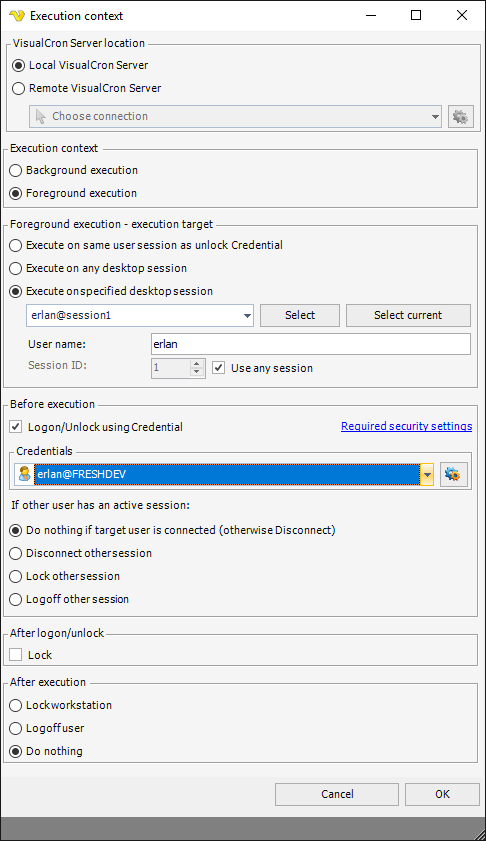

## Task Office - Office - Macro

The Office macro Task runs a macro in an Excel workbook, PowerPoint presentation, Access database or Word document, optionally with parameters. Microsoft Office must be installed on the computer that runs the VisualCron Server.


:::warning

Before it runs the macro, the Task changes the Office security settings of the user it runs as: it adds the folder of the document to the Office trusted locations of that application, and it sets that application's macro security to enable all macros. The Task makes these changes only when the Office security keys exist in that user's registry. With no Credential, these are the settings of the account that the VisualCron Server runs as. These changes stay after the Task ends. Run the Task with a Credential for a user that is meant only for this purpose.

:::

The ***Main settings***, ***Flow***, ***On error***, ***Conditions*** and ***TimeOut*** tabs are the same for every Task; see [Job - Tasks](../../job-tasks).

### Office macro tab

- _Credentials_: The Credential of the user that runs Office and the macro; see [Credentials](../../global-credentials)

  Select a Credential in the combo box, or click the _Settings_ icon to add or edit Credentials.

**File**

- _Type_: The Office application: "Excel", "Access", "Word" or "Powerpoint"
- _Execute in 32bit mode_: Runs the macro in a 32-bit process; select it when the installed Office is 32-bit
- _Path_: The full path of the document that contains the macro; it can contain Variables
- _Password_: The password of the document, used for Excel and Access only; leave it empty if the document has no password

  The password is stored in the Task settings as plain text.

- _Update file after execution_: Selected by default; saves the document after the macro runs, for Excel and Access only
- _CallQuit_: Selected by default; for Excel, quits Excel after the macro

  The Excel process that the Task started is ended after the macro in any case. Word, PowerPoint and Access are always closed after the macro.

- _Visible_: Shows the Office application window while the macro runs; cleared by default, so the macro runs in the background

**Macro name**

- _Macro name_: The name of the macro, without the file path, for example `CalcSomething`; it can contain Variables

  For a macro in a specific module, use `ModuleName.MacroName`, for example `MainModule.CalcSomething`. With Access, the Task runs an Access macro by name.

**Parameters**

If the macro takes parameters, click _Add_, _Edit_ and _Delete_ to manage them, in the order the macro expects. The Task passes at most 10 parameters.


- _Type_: The data type of the parameter, for example "String", "Int32" or "DateTime"
- _Value_: The value; it can contain Variables, which are resolved when the Task runs
- _Validate value_: Checks that the value converts to the selected type when you click _Ok_

  Clear it when the value is a Variable, because the Variable may have no value yet.

### Output and errors

The output of the Task is the return value of the macro, if it returns one. When the document is not found, or Office reports an error, the Task fails and the error text is in the error output.

:::warning

When more than 10 parameters are defined, the macro is not run, and the Task reports success. With Excel and _Update file after execution_, the workbook is still saved.

:::

### Troubleshooting

**The macro hangs, runs forever or does not do what it should**

The Task drives an Office desktop application from the VisualCron Server, which runs as a Windows service. Office then runs without a visible desktop, so when Office stops on an error or a prompt, nothing shows it and the Task appears to hang.

To find the cause:

1. Download the test macro from [https://www.visualcron.com/files/support/WriteFile.zip](https://www.visualcron.com/files/support/WriteFile.zip). It writes a text file to the root of drive C:.
2. Unzip it to a local folder.
3. Create a Job with an Office macro Task with these settings:


4. Save the Job.
5. Run the Job.
6. Check whether the test macro created its text file in the root of drive C:.

If the test fails, the cause is likely on the computer, such as a faulty Office installation or missing permissions. If the test works but your macro does not, add logging to your macro, for example by writing a line to a file after each step, as the test macro does, to find the line that fails. You might need to set a [Credential](../../global-credentials) in the Task.

Common causes:

1. _Execute in 32bit mode_ does not match the installed Office.
2. The macro was not tested on the local computer first.
3. _Macro name_ contains a path instead of only the macro name.
4. _Visible_ is selected; use the default settings with _Visible_ cleared.
5. The Credential is missing or wrong.

Other Task types can run the macro instead:

1. The Execute Script Task, with this code in a ".vbs" file:

```vb
Set objExcel = CreateObject("Excel.Application")
objExcel.Application.Run "'C:\Data\Sales.xlsm'!SalesModule.SalesTotal"
objExcel.DisplayAlerts = False
objExcel.Application.Quit
Set objExcel = Nothing
```

2. The Execute Task, with the full path of Excel.exe as the command and the full path of the workbook, with the module and macro name, as the argument, for example `'C:\Data\Sales.xlsm'!SalesModule.SalesTotal`. You might need to set a Credential in the Task.
3. The Execute Task in foreground mode: the same settings as in 2, without the Credential, and with the execution context on the ***Main settings*** tab set like this (see [Task - Execution context](../../task-main-settings-execution-context)):



**System.Reflection.TargetInvocationException: Exception has been thrown by the target of an invocation. ---> System.Runtime.InteropServices.COMException (0x800A03EC): Microsoft Excel cannot access the file 'C:\your file.xlsm'.**

1. Create the folder `C:\Windows\SysWOW64\config\systemprofile\Desktop` (64-bit Windows) or `C:\Windows\System32\config\systemprofile\Desktop` (32-bit Windows).
2. Give the user "SYSTEM" Full control of that Desktop folder.

On 64-bit Windows, do this for both folders.

**System.Runtime.InteropServices.COMException (0x800A07D1): You canceled the previous operation.**

Run the Task with a Credential that has _Local logon_ and _Load profile_ selected.

**System.Runtime.InteropServices.COMException (0x800A03EC): Cannot run the macro Macro1'**

The macro may not be in this workbook, or all macros may be disabled.

Open the document, find the macro in the list of macros, and enter its full name, for example `MainModule.CalcSomething`.

**Faulting application name: EXCEL.EXE**

An entry like this in the Windows event log:

```text
Faulting application name: EXCEL.EXE, version: 15.0.4719.1000, time stamp: 0x552cf4af
Faulting module name: VBE7.DLL, version: 0.0.0.0, time stamp: 0x54d16140
Exception code: 0xc0000005
Fault offset: 0x00008c0e
Faulting process id: 0x2914
Faulting application start time: 0x01d0a28e5b929b88
Faulting application path: C:\Program Files\Microsoft Office 15\Root\Office15\EXCEL.EXE
Faulting module path: C:\Program Files (x86)\Common Files\Microsoft Shared\VBA\VBA7.1\VBE7.DLL
Report Id: 9a82692d-0e81-11e5-9bb4-989096a28d27
```

**Solution 1: recompile the project**

1. Open the workbook in Excel. Excel normally disables the macros until you enable them; do not enable them yet.
2. Open the VBA editor: press ALT+F11, or on the ribbon click _Developer_ -> _Visual Basic_.
3. In the VBA editor, double-click the first module of your project.
4. Add a comment line, such as `' This is a comment`.
5. Click _Debug_ -> _Compile VBA Project_.
6. Repeat steps 3 to 5 for each module.
7. Save the workbook.
8. Close the workbook.
9. Open the workbook and enable the macros.
10. Test the macro.

**Solution 2: turn off Compile On Demand**

In the VBA editor, click _Tools_ -> _Options_, and on the ***General*** tab clear _Compile On Demand_.

Alternatively, set this registry value:

```text
Key:   HKEY_CURRENT_USER\Software\Microsoft\VBA\7.0\Common
Name:  CompileOnDemand
Type:  DWORD
Value: 0
```

**COMException 0x800706BA or 0x800706BE**

System.Runtime.InteropServices.COMException (0x800706BE): The remote procedure call failed. (Exception from HRESULT: 0x800706BE)

Comment out any Quit command in your macro.
