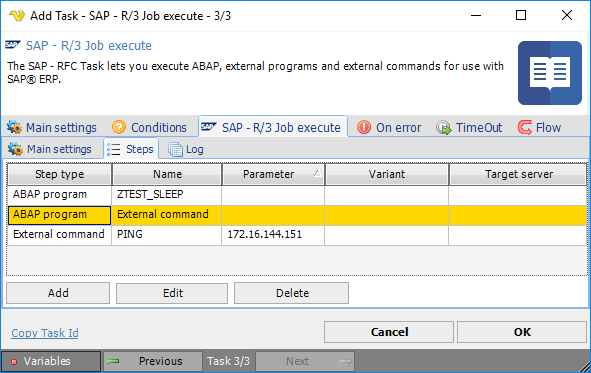
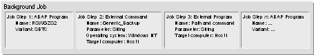
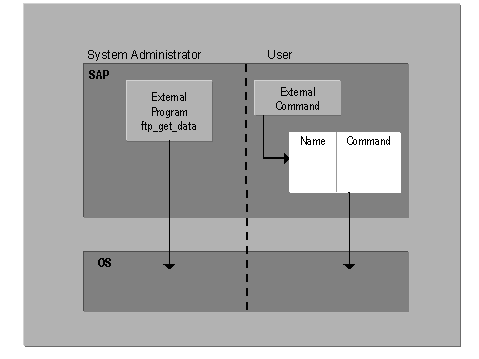
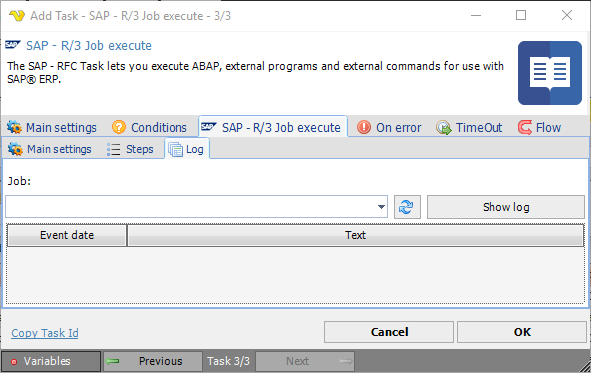

## Task SAP - R/3 Job Execute

The SAP - R/3 Job execute Task creates a SAP background job with one or more steps (ABAP programs, external commands or external programs), runs it, and writes the job log to the output, using a SAP Connection.

The ***Main settings***, ***Flow***, ***On error***, ***Conditions*** and ***TimeOut*** tabs are the same for every Task; see [Job - Tasks](../../job-tasks).

The ***SAP - R/3 Job execute*** tab has three sub tabs: ***Main settings***, ***Steps*** and ***Log***.

### SAP - R/3 Job execute: Main settings tab

- **Connection**: the SAP Connection to the SAP system; see [Connection - SAP](../../connection-sap). Click the settings button to manage Connections
- _Job_: the base name of the SAP background job. Each run creates a new job named after this value, followed by a hyphen and a number for the run, cut to 32 characters
- _SAP user_: the SAP user the job steps run as, "test" by default. When it is empty, the user of the Connection is used
- _Delete Job when complete_: checked by default. Deletes the job from the SAP system after it has run, also when it failed
- _Wait for completion - with interval_: checked by default, with the interval "3". The Task always waits while SAP reports the job as running, and checks its status every 3 seconds, whatever this setting says

### Steps tab

The work unit of the SAP background processing system is the background job, and each job has one or more job steps. Several programs needed to complete one piece of work can run as steps of a single job.

The list shows the columns _Step type_, _Name_, _Parameter_, _Variant_ and _Target server_. Use _Add_, _Edit_ and _Delete_, or double-click a row, to change the steps. The steps run in the order of the list.

#### Add/Edit SAP step window

- _Step type_:
  - "ABAP program": runs an ABAP program. _Variant_ is available; _Parameter_ and _Target server_ are not
  - "External command": runs a predefined command that is protected by authorizations. _Parameter_ and _Target server_ are available; _Variant_ is not
  - "External program": runs any command or program of the host operating system. _Parameter_ and _Target server_ are available; _Variant_ is not
- _Name_: the name of the ABAP program, external command or external program. Click the refresh button to fill the list from the SAP system ("ABAP program" and "External command")
- _Variant_: the variant of the ABAP program. Click the refresh button to load the variants of the selected program
- _Parameter_: the parameters for the external command or program
- _Target server_: the host on which the external command or program runs

Name, variant, parameter and target server may contain Variables.

#### Step types in detail

The SAP background processing system separates external commands, for normal users, from external programs, for system administrators. Transaction SM36 shows the same separation, with separate fields for external commands and external programs. ABAP programs can also be called.

- ABAP programs: module pools and function groups (collections of ABAP modules) are not allowed. A step needs the ABAP program and a variant
- External commands: predefined commands for end users, protected by authorizations. They do not depend on the operating system, and end users can schedule only the commands that the system administrator allows
- External programs: commands that are neither predefined nor restricted by authorizations. A user with administrator authorization can enter any of them in a job step

### Log tab

- _Job_: a job that has run. Click the refresh button to update the list
- _Show log_: shows the log entries of the selected job, with their date and text

### Output and errors

The output is the log of the SAP job. If the job does not finish successfully, the Task fails with the message "SAP job aborted. See output log."

:::warning

The Task waits only while SAP reports the job as running. If the job has not started running at the first status check, the Task reports it as aborted and, with _Delete Job when complete_ checked, deletes it.

:::

 If the job log cannot be read, the error output says so and the result of the Task is not changed.
