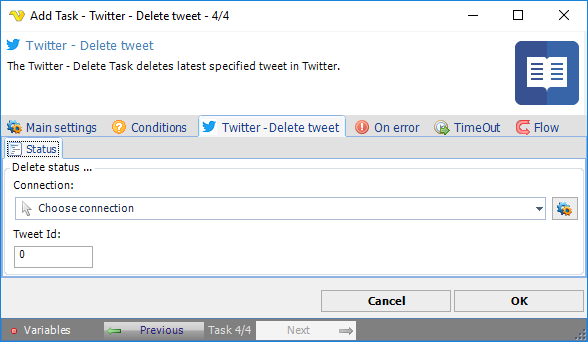

:::warning

**Deprecated**

Twitter integration described on this page is deprecated from **VisualCron v13.2.1**.

:::

## Task Social - Twitter - Delete Tweet

The Twitter - Delete tweet Task deletes the latest or a specified tweet in Twitter.

The ***Main settings***, ***Flow***, ***On error***, ***Conditions*** and ***TimeOut*** tabs are the same for every Task; see [Job - Tasks](../../job-tasks).

### Twitter - Delete tweet: Status tab

- _Connection_: the Twitter Connection to use; see [Twitter Connection](../../../server/connection-twitter)
- _Tweet Id_: the ID of the tweet to delete; "0" (default) specifies the latest tweet
