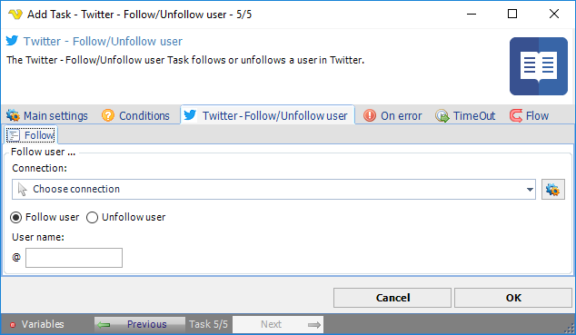

:::warning

**Deprecated**

Twitter integration described on this page is deprecated from **VisualCron v13.2.1**.

:::

## Task Social - Twitter - Follow/Unfollow Tweet

The Twitter - Follow/Unfollow user Task follows or unfollows a user in Twitter.

The ***Main settings***, ***Flow***, ***On error***, ***Conditions*** and ***TimeOut*** tabs are the same for every Task; see [Job - Tasks](../../job-tasks).

### Twitter - Follow/Unfollow user: Follow tab

- _Connection_: the Twitter Connection to use; see [Twitter Connection](../../../server/connection-twitter)
- _Follow user_ (default) or _Unfollow user_: whether to follow or unfollow the user
- _User name_: the Twitter user name, without "@"
