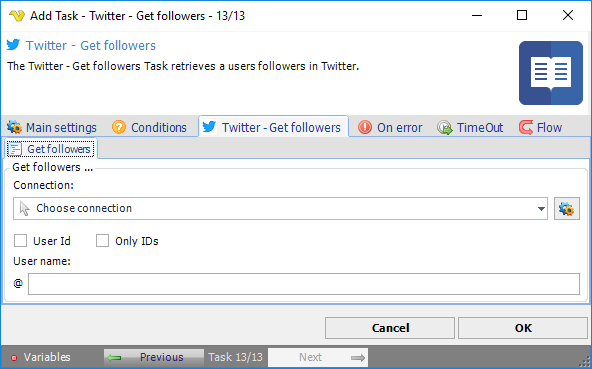

:::warning

**Deprecated**

Twitter integration described on this page is deprecated from **VisualCron v13.2.1**.

:::

## Task Social - Twitter - Get Followers

The Twitter - Get followers Task retrieves a user's followers in Twitter.

The ***Main settings***, ***Flow***, ***On error***, ***Conditions*** and ***TimeOut*** tabs are the same for every Task; see [Job - Tasks](../../job-tasks).

### Twitter - Get followers tab

- _Connection_: the Twitter Connection to use; see [Twitter Connection](../../../server/connection-twitter)
- _User Id_: when checked, _User name_ holds the numeric user ID instead of the screen name
- _Only IDs_: return only the ID numbers of the followers
- _User name_: the screen name, or with _User Id_ the user ID, of the user whose followers to return

See Twitter Developer Documentation for detailed [GET followers](https://developer.twitter.com/en/docs/twitter-api/v1/accounts-and-users/follow-search-get-users/api-reference/get-followers-ids) information.
