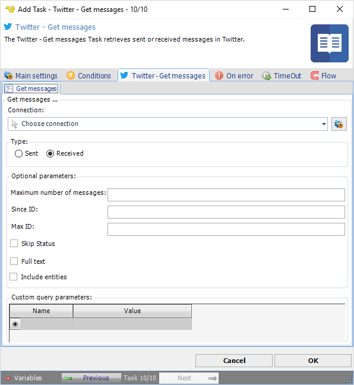

:::warning

**Deprecated**

Twitter integration described on this page is deprecated from **VisualCron v13.2.1**.

:::

## Task Social - Twitter - Get Messages

The Twitter - Get messages Task retrieves sent or received direct messages in Twitter.

The ***Main settings***, ***Flow***, ***On error***, ***Conditions*** and ***TimeOut*** tabs are the same for every Task; see [Job - Tasks](../../job-tasks).

### Twitter - Get messages tab

- _Connection_: the Twitter Connection to use; see [Twitter Connection](../../../server/connection-twitter)
- _Sent_ or _Received_ (default): which messages to retrieve
- _Maximum number of messages_: the number of direct messages to try to retrieve, up to 200
- _Since ID_: return results with an ID greater than (that is, more recent than) the specified ID
- _Max ID_: return results with an ID less than (that is, older than) or equal to the specified ID
- _Page number_: with _Sent_, the page of results to return
- _Skip Status_: with _Received_, when checked, statuses are not included in the returned user objects
- _Full text_: return the full text of each message
- _Include entities_: when cleared, the entities node is not included
- _Custom query parameters_: more parameters for the request, one row each with _Name_ and _Value_

See Twitter Developer Documentation for detailed [GET messages](https://developer.twitter.com/en/docs/twitter-api/v1/direct-messages/sending-and-receiving/api-reference/get-event) information.
