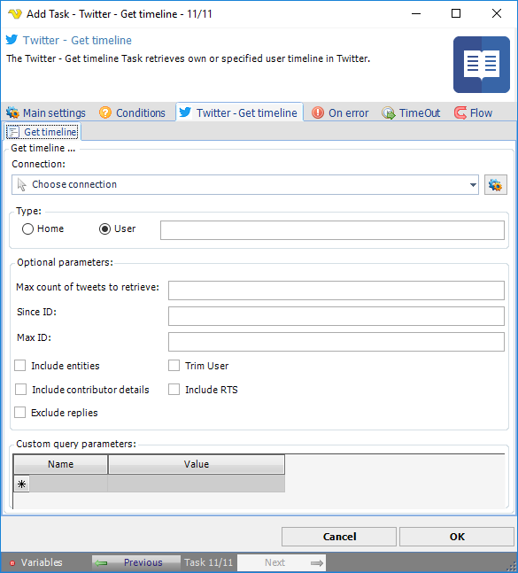

:::warning

**Deprecated**

Twitter integration described on this page is deprecated from **VisualCron v13.2.1**.

:::

## Task Social - Twitter - Get Timeline

The Twitter - Get timeline Task retrieves the home timeline or the timeline of a specified user in Twitter.

The ***Main settings***, ***Flow***, ***On error***, ***Conditions*** and ***TimeOut*** tabs are the same for every Task; see [Job - Tasks](../../job-tasks).

### Twitter - Get timeline tab

- _Connection_: the Twitter Connection to use; see [Twitter Connection](../../../server/connection-twitter)
- _Home_ or _User_ (default): the home timeline of the Connection, or the timeline of the user entered in the box next to _User_
- _Max count of tweets to retrieve_: the number of tweets to try to retrieve, up to 200 per request
- _Since ID_: return results with an ID greater than (that is, more recent than) the specified ID
- _Max ID_: return results with an ID less than (that is, older than) or equal to the specified ID
- _Include entities_: when cleared, the entities node is not included
- _Exclude replies_: keep replies out of the returned timeline
- _Trim User_: when checked, each returned tweet includes a user object with only the numeric ID of the author
- _Include contributor details_: include contributor details in the results
- _Include RTS_: with _User_, include retweets
- _Custom query parameters_: more parameters for the request, one row each with _Name_ and _Value_

See Twitter Developer Documentation for detailed [GET timeline](https://developer.twitter.com/en/docs/api-reference-index) information.
