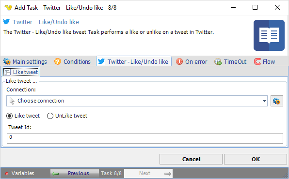

:::warning

**Deprecated**

Twitter integration described on this page is deprecated from **VisualCron v13.2.1**.

:::

## Task Social - Twitter - Like/Undo Like

The Twitter - Like/Undo like Task likes a tweet, or removes a like, in Twitter.

The ***Main settings***, ***Flow***, ***On error***, ***Conditions*** and ***TimeOut*** tabs are the same for every Task; see [Job - Tasks](../../job-tasks).

### Twitter - Like/Undo like: Like tweet tab

- _Connection_: the Twitter Connection to use; see [Twitter Connection](../../../server/connection-twitter)
- _Like tweet_ (default) or _Unlike tweet_: whether to like the tweet or remove a previous like
- _Tweet Id_: the ID of the tweet, the number at the end of the link to the tweet
