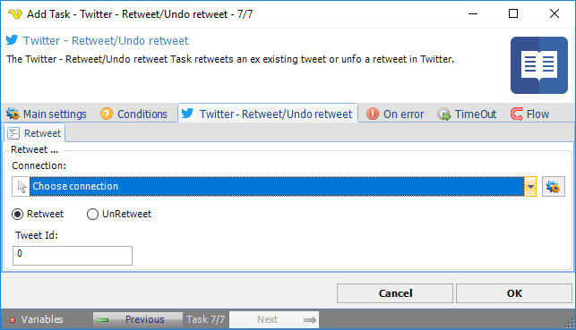

:::warning

**Deprecated**

Twitter integration described on this page is deprecated from **VisualCron v13.2.1**.

:::

## Task Social - Twitter - Retweet/Undo Retweet

The Twitter - Retweet/Undo retweet Task retweets an existing tweet, or undoes a retweet, in Twitter.

The ***Main settings***, ***Flow***, ***On error***, ***Conditions*** and ***TimeOut*** tabs are the same for every Task; see [Job - Tasks](../../job-tasks).

### Twitter - Retweet/Undo retweet tab

- _Connection_: the Twitter Connection to use; see [Twitter Connection](../../../server/connection-twitter)
- _Retweet_ (default) or _UnRetweet_: whether to retweet the tweet or undo a previous retweet by the account of the Connection
- _Tweet Id_: the ID of the tweet, the number at the end of the link to the tweet
