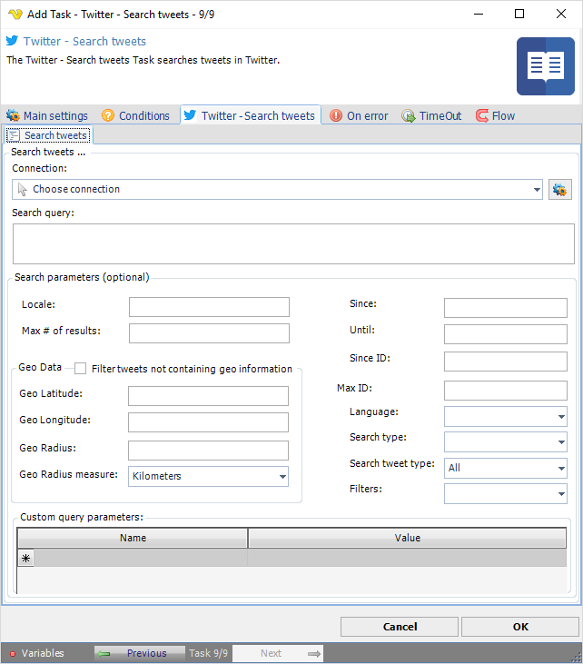

:::warning

**Deprecated**

Twitter integration described on this page is deprecated from **VisualCron v13.2.1**.

:::

## Task Social - Twitter - Search Tweets

The Twitter - Search tweets Task searches tweets in Twitter.

The ***Main settings***, ***Flow***, ***On error***, ***Conditions*** and ***TimeOut*** tabs are the same for every Task; see [Job - Tasks](../../job-tasks).

### Twitter - Search tweets tab

- _Connection_: the Twitter Connection to use; see [Twitter Connection](../../../server/connection-twitter)
- _Search query_: a UTF-8, URL-encoded search query of up to 500 characters, including operators. Required
- _Locale_: the language of the query, for language-specific consumers. The default works in most cases
- _Max # of results_: the number of tweets to return per page, up to 100. The default is 15
- _Since_ and _Until_: return tweets created after or before the given date, formatted as `YYYY-MM-DD`
- _Since ID_: return results with an ID greater than (that is, more recent than) the specified ID
- _Max ID_: return results with an ID less than (that is, older than) or equal to the specified ID
- _Language_: return tweets in the language given by an [ISO 639-1](https://en.wikipedia.org/wiki/List_of_ISO_639_language_codes) code
- _Search type_, _Search tweet type_ and _Filters_: the kind of results and the tweet types to return. _Search tweet type_ is "All" by default
- _Geo Data_: return tweets by users within _Geo Radius_, in the _Geo Radius measure_ unit ("Kilometers" by default), of _Geo Latitude_ and _Geo Longitude_. _Filter tweets not containing geo information_ leaves out tweets without location data
- _Custom query parameters_: more parameters for the request, one row each with _Name_ and _Value_

See Twitter Developer Documentation for detailed [GET search/tweets](https://developer.twitter.com/en/docs/api-reference-index) information.
