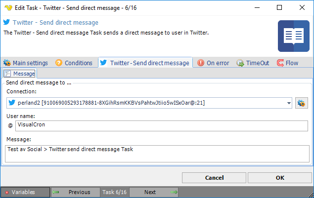

:::warning

**Deprecated**

Twitter integration described on this page is deprecated from **VisualCron v13.2.1**.

:::

## Task Social - Twitter - Send Direct Message

The Twitter - Send direct message Task sends a direct message to a user in Twitter.

The ***Main settings***, ***Flow***, ***On error***, ***Conditions*** and ***TimeOut*** tabs are the same for every Task; see [Job - Tasks](../../job-tasks).

### Twitter - Send direct message: Message tab

- _Connection_: the Twitter Connection to use; see [Twitter Connection](../../../server/connection-twitter)
- _User name_: the Twitter user to send the message to, without "@"
- _Message_: the message to send

:::info Note

You cannot send a message to a user who does not follow you.

:::
