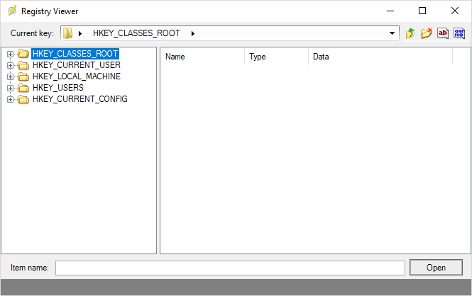

## Task System - Registry

The Registry Task reads, creates, changes, renames and deletes registry values and keys on the VisualCron Server computer.

The ***Main settings***, ***Flow***, ***On error***, ***Conditions*** and ***TimeOut*** tabs are the same for every Task; see [Job - Tasks](../../job-tasks).

The Task has no Credential: it runs as the account of the VisualCron Server service. So `HKEY_CURRENT_USER` is the registry of that account (SYSTEM by default), not of a logged-on user.

### Registry tab

- _Type of Registry task_: the operation

  - "Read value data" (default): writes the data of the value to the Task output. String and DWORD values are written as text; multi-string and binary values are written as their type name, not their data. The Task fails when the value does not exist
  - "Create/Change value data": creates the value in an existing key, or changes it when it exists. Select "String" (default) or "DWORD" as the data type; DWORD data must be a whole number
  - "Delete value": deletes the value
  - "Rename Value": gives the value a new name. The Task fails when the value does not exist or the new name is already used
  - "Create key": creates the key. The Task fails when the key already exists
  - "Delete key": deletes the key with all its subkeys and values
  - "Rename key": copies the key, with its values and subkeys, to the new name and then deletes the original key. Permissions set on the original key are not copied

- _Registry key_: the full path of the key, starting with the full name of the root key, for example `HKEY_LOCAL_MACHINE\SOFTWARE\MyCompany`. Short forms such as `HKLM` are not recognized. Click the browse button to select a key in the _Registry Viewer_ window

  

  The _Registry Viewer_ shows the registry of the computer that the Client runs on. When that is not the VisualCron Server computer, check that the key exists on the Server computer.

- _Value Name_: the name of the value. Used with "Read value data", "Create/Change value data", "Delete value" and "Rename Value"
- _Value Data_: the data to write. Used with "Create/Change value data"
- _New Name_: the new name. Shown in place of _Value Data_ with "Rename Value" (renames the value) and "Rename key" (renames the key)

:::warning

"Delete key" deletes the key with all its subkeys and values, and "Rename key" deletes the original key after copying it. There is no confirmation and no undo.

:::

### Output and errors

With "Read value data", the output is the value data. The other operations write no output. When an operation fails, the Task fails.
