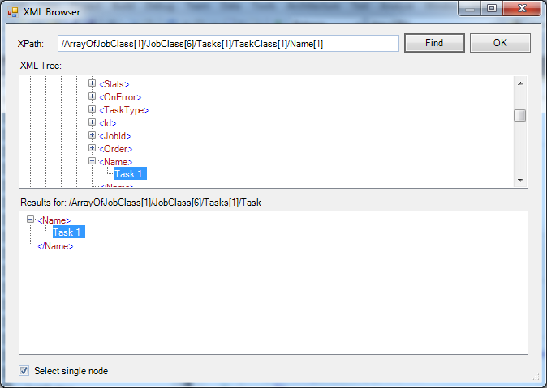

## Task XML - Read Node

The Read Node Task reads one or more nodes from an XML file or from XML text, with or without the surrounding XML tags, and returns them as the output of the Task.


The ***Main settings***, ***Flow***, ***On error***, ***Conditions*** and ***TimeOut*** tabs are the same for every Task; see [Job - Tasks](../../job-tasks).

:::warning

In these cases the output is empty or incomplete, no error is raised, and the Task reports success:

- _Select single node_ is cleared and the XPath expression selects no node
- _Attribute (optional)_ is set and a selected node does not have that attribute
- _Attribute (optional)_ is set and "Outer XML" is selected on the ***Output*** tab

:::

### Read Node tab

- _Credentials_: The Credential the Task uses to read the file. It is used only with _File_. With no Credential, the file is read under the account of the VisualCron Server
- _File_: Select to read an XML file, then enter its full path
- _Variable/Value_: Select to read XML text, then enter the XML or a Variable that holds it
- _XPath expression_: The XPath expression that selects the node or nodes to read. To build the expression, click the button next to the field and select a node in the XML Browser; the button is available when the file path or the XML text is set
- _Evaluate the specified XPath expression and return the typed result_: When selected, the Task evaluates the XPath expression and returns its result as text, for example the number that `count(//item)` returns. _Attribute (optional)_ and _Select single node_ are then not available
- _Attribute (optional)_: The name of an attribute. When set, the Task returns the value of this attribute instead of the node
- _Select single node_: When selected, the default, the Task returns only the first node that the XPath expression selects. When cleared, it returns every selected node, each on its own line
- _Namespaces_: The namespace prefixes and URIs that the XPath expression can use. When the list is empty, the Client fills it with the namespaces declared in the XML, with the prefix "x" for a default namespace. Use _Add_, _Edit_ and _Remove_ to change the list, and _Reload_ to read the namespaces again

At run time, the Task also adds the namespaces declared in the XML, with the prefix "x" for a default namespace ("xx" if "x" is already in use). With _Select single node_, when the XPath expression selects nothing, the Task tries it again with a namespace prefix added to each step of the path that has none.

Variables can be used in the file path, the XML text, _XPath expression_ and _Attribute (optional)_.

**XML Browser**



The XML Browser shows the XML as a tree. Select a node to get its XPath expression, then click _OK_ to copy the expression to _XPath expression_.

### Output tab


- _Inner XML_: The default. The output is the content of the node, without its own start and end tags. Attribute values and evaluated results are returned with this option only
- _Outer XML_: The output is the node with its own start and end tags

:::info Note

If the XPath expression returns nothing for an XML document with a default namespace, use a prefix for that namespace in each step of the path. For example, for this XML:

```xml
<?xml version="1.0" encoding="UTF-8"?>
<jobInfo xmlns="http://www.force.com/2009/06/asyncapi/dataload">
  <id>12345</id>
</jobInfo>
```

use this XPath expression, with the prefix "x" for the default namespace:

```text
/x:jobInfo[1]/x:id[1]
```

:::

### Output and errors

- With _Select single node_, when the XPath expression selects no node, the Task raises the error "XPath query returned nothing", which is selected by default on the ***On error*** tab
- When the file cannot be read or the XML is not valid, the Task fails
