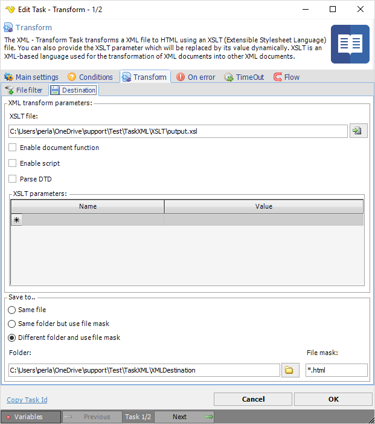

## Task XML - Transform

The XML - Transform Task transforms the XML files that its File filter selects with an XSLT (Extensible Stylesheet Language Transformations) style sheet, and saves each result as a file. The result can be HTML, XML or text, as the output method of the style sheet sets. XSLT parameters can pass values, including Variables, to the style sheet at run time.

The ***Main settings***, ***Flow***, ***On error***, ***Conditions*** and ***TimeOut*** tabs are the same for every Task; see [Job - Tasks](../../job-tasks).

:::warning

With the default **Save to..** option _Same folder but use file mask_ and the default _File mask_ `*`, the result gets the name of the source file in the same folder, so it replaces the source file. _Same file_ also replaces the source file. When the result replaces the source file and the transformation fails, the source file can be left empty or incomplete. To keep the source files, set a _File mask_ such as `*.html`, or save to a different folder.

When the File filter finds no file, no error is raised, and the Task reports success. To have it fail the Task, select "All errors" on the ***On error*** tab; see [Task - On Error](../../task-on-error).

:::

### Transform: File filter tab

The File filter selects the XML files to transform; see [File Filter](../../job-tasks-file-filter). The Credential of the File filter is used to read and save the files.

### Transform: Destination tab

**XML transform parameters**

- _XSLT file_: The path and file name of the XSLT style sheet. Click the icon next to the field to browse for the file
- _Enable document function_: When selected, the style sheet can use the XSLT `document()` function to read other XML documents. Cleared by default
- _Enable script_: When selected, the style sheet can run embedded script blocks. Cleared by default. Select it only for style sheets you trust, because the script runs on the VisualCron Server
- _Parse DTD_: When selected, a DTD in the source document is processed and the document is validated against it. Cleared by default. A source document that contains a DTD can only be transformed with this option selected

**XSLT parameters**

Enter a _Name_ and a _Value_ in the empty row of the grid to add a parameter. The parameters are passed to the style sheet, which reads them with `xsl:param`. To delete a parameter, select its row and press the Delete key.

**Save to..**

- _Same file_: The result replaces the source file
- _Same folder but use file mask_: The default. The result is saved in the folder of the File filter, with the name that _File mask_ gives
- _Different folder and use file mask_: The result is saved in _Folder_, with the name that _File mask_ gives
- _Folder_: The destination folder. Available with _Different folder and use file mask_
- _File mask_: The name of the result file. `*` keeps the name of the source file. Available with both file mask options

Variables can be used in _XSLT file_, the parameter names and values, _Folder_ and _File mask_.

### Output and errors

- The output of the Task contains the path of each saved file. When several files are transformed, the paths follow each other without a separator
- The files are transformed one by one. When a file cannot be transformed, the Task fails, and the remaining files are not transformed
