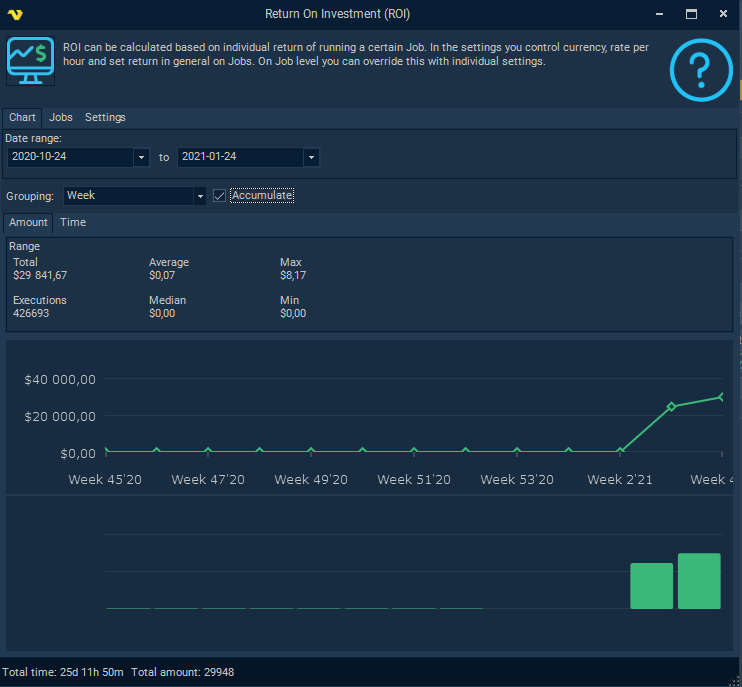
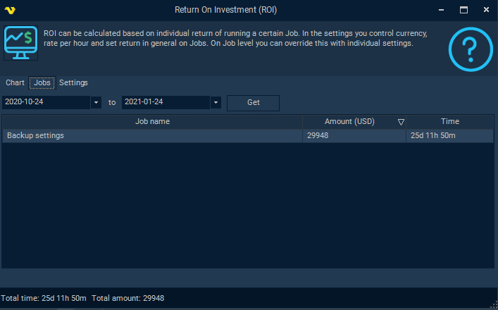
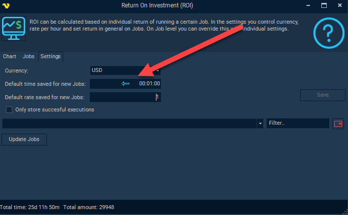

## ROI - Return On Investment

The _Return On Investment (ROI)_ window shows how much time and money your Jobs save. Each Job run counts the time the Job saves and the hourly rate that time is worth. For example, a Job that saves 1 hour at a rate of "50" returns 50 each time it runs.

To open it, click the main menu _Server_ -> _Jobs_ -> _ROI_. Not every edition includes this window.

The window has three tabs: **_Chart_** shows the combined ROI of all Jobs over time, **_Jobs_** lists the total per Job, and **_Settings_** holds the currency and the values new Jobs start with.

### How ROI is calculated

- Each Job has its own ROI settings: the time it saves per run and an hourly rate (see the ROI settings in [Job - Main Settings](job-main-settings))
- When a Job run ends, the Server stores that run's time and rate in the Job log of the log database; ROI is recorded only when _Log to database_ is on in [Settings - Log Settings](settings-log-settings), and it is kept as long as the Job log is kept
- The amount of a run is the time saved, in hours, multiplied by the hourly rate; a run that saves 15 minutes at a rate of "50" returns 12.5
- The time and rate are stored with each run, so changing them later does not change runs that are already recorded
- If _Only store successful executions_ is checked in a Job's ROI settings, a failed run of that Job is recorded with no time and no amount

:::note

The Server uses the time and rate stored in each Job. When _Use default Job time_ or _Use default Job rate_ is checked for a Job, the Job takes the default value from the **_Settings_** tab at the moment you click _OK_ in its ROI settings. Later changes to the defaults reach that Job only when you open and confirm its ROI settings again, or use _Update Jobs_. A new Job whose ROI settings are never opened uses a time of 15 minutes and a rate of "50".

:::
 
### Chart tab

The **_Chart_** tab shows the combined ROI of all Jobs for a date range.

- _Date range_: the period to show; by default the last three months up to today
- _Grouping_: how runs are grouped on the chart: "None", "Day", "Week", "Month" or "Year"; "Week" is selected when the window opens
- _Accumulate_: when checked, each point adds to the previous ones, so the chart shows a running total
- **_Amount_** and **_Time_**: show the chart in money or in time saved

Above the chart, the window shows the total for the range and the statistics _Executions_, _Average_, _Median_, _Min_ and _Max_. When _Grouping_ is "None", these count and compare single runs. With any other grouping they count and compare the groups: for example, with "Week", _Executions_ is the number of weeks in the range that have runs, and _Average_ is the average per week. The chart counts every logged run, including runs of deleted Jobs and runs with no ROI, so its totals can differ from the **_Jobs_** tab.

:::note

"Week" groups runs by week number only, so the same week number from different years is combined into one point. Keep the date range under one year when you use "Week".

:::

_Server_ -> _Jobs_ -> _ROI_ -> **_Chart_**

### Jobs tab

The **_Jobs_** tab lists the total ROI per Job for its own date range, by default the last three months up to today. The list loads the first time you open the tab. Click _Get_ to load it again after you change the dates.

- _Job name_: the Job
- _Amount_ (with the currency): the total amount for the range
- _Time_: the total time saved for the range

The list is sorted by amount, highest first, and shows only existing Jobs with an amount above zero. The status bar shows _Total time_ and _Total amount_ for the list.

_Server_ -> _Jobs_ -> _ROI_ -> **_Jobs_**

### Settings tab

The **_Settings_** tab holds the currency and the values that new Jobs start with. A Job takes these values when its ROI settings are confirmed (see the note under [How ROI is calculated](#how-roi-is-calculated)).

- _Currency_: the currency the window shows amounts in; default "USD"
- _Default time saved for new Jobs_: the time a Job saves per run when it uses the default time; default "00:01:00"
- _Default rate saved for new Jobs_: the hourly rate, as a whole number, when a Job uses the default rate; default "1"
- _Only store succesful executions_: the starting value of the same option in each new Job; default unchecked; each Job keeps its own setting

_Save_ saves the settings to the Server and closes the window. It is available only after you change a setting. Saving requires the "Server settings" permission with "Edit" (see [Main - User Permissions](main-user-permissions)).

:::warning

Without the "Server settings" permission with "Edit", _Save_ closes the window but the Server does not store the change, and no message is shown.

:::

#### Update Jobs

Use _Update Jobs_ to give several Jobs the same ROI settings.

1. In the Job list below the settings, select the Jobs to update
2. Click _Update Jobs_; the _Job ROI settings_ window opens with the values from this tab, and with _Use default Job time_ and _Use default Job rate_ cleared
3. Change the settings if needed, then click _OK_

The settings are written to every selected Job, and a message confirms when the update is complete. You can cancel while the update runs; Jobs that were already updated keep the new settings.

:::warning

_Update Jobs_ replaces the ROI settings of every selected Job, including Jobs that had their own time or rate. Check the Job selection before you click _OK_.

:::

_Server_ -> _Jobs_ -> _ROI_ -> **_Settings_**

