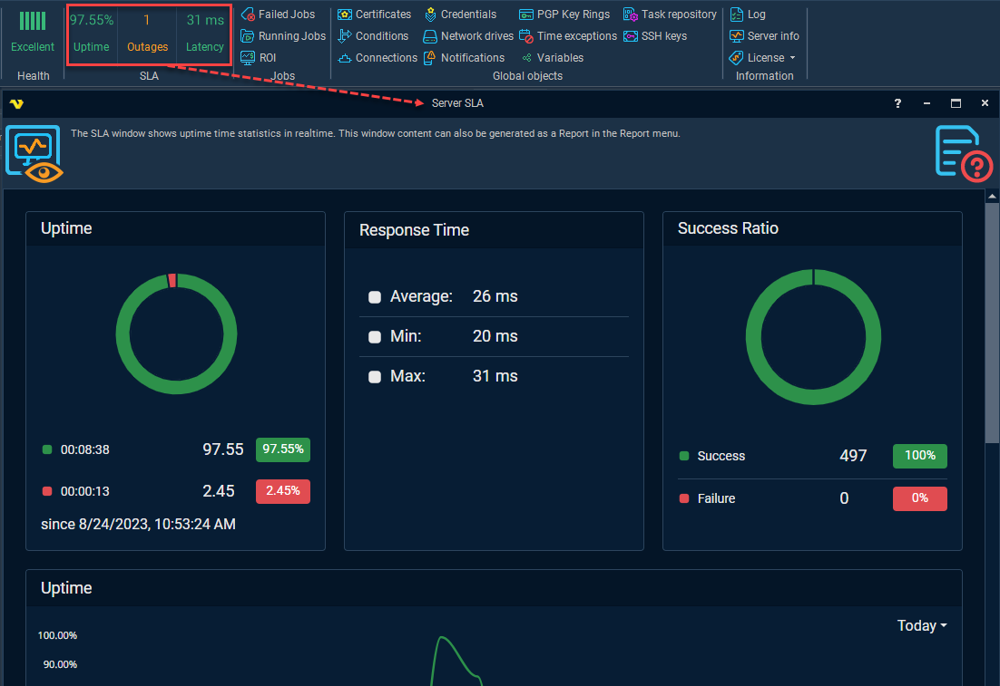

## SLA - Uptime, Outages, Latency

The main menu _Server_ -> _SLA_ group shows three service-level values for the Server you are connected to. They show how much of the last day the Server was running, how often it went down, and how quickly it answers. Use them to check the Server's availability, or to choose a Server in a load balancing setup.

Each value refreshes once a minute. Until the Server has collected statistics, the buttons show no value.

### Uptime

The share of the last 24 hours that the VisualCron Server service was running, as a percentage. If the Server has collected statistics for less than 24 hours, for example after a new installation, the percentage covers that shorter period. Turning the Server "Off" does not lower uptime, because the service keeps running.

### Outages

The number of times in the last 24 hours that the VisualCron Server service was not running. An outage is recorded when the service starts again, so stopping or restarting the service, a crash and a shutdown of the computer each count as one outage.

### Latency

The highest response time, in milliseconds, in about the last minute. It is measured from the ping round trips of logged-on Clients and, in a load balancing setup, from the Server's own pings to the load balancing broker. When no new measurements arrive, for example when no Client is connected, the last value is kept.

### Server SLA window

Click any of the three buttons to open the _Server SLA_ window, which updates in real time. Not every edition includes this window; if yours does not, the Client shows a "Feature not available" message instead. The same content is available as the _Server: SLA_ report on the Reports menu (see [Reports](../reports)).

_Server_ -> _SLA_ -> _Uptime_, _Outages_ or _Latency_

The window shows:

- _Uptime_: running and down time in the same period as the _Uptime_ button, as times and percentages, with the date the period starts
- _Response Time_: the _Average_, _Min_ and _Max_ response time in about the last minute
- _Success Ratio_: the number and share of successful and failed Job runs, read from the Job log in the log database, so it depends on _Log to database_
- Charts of the Server's history, with a list for the time range, for example "Today"

### Stored data

The Server keeps its SLA statistics in a file in the Server's settings folder, not in the log database, so the Uptime, Outages and Latency values do not depend on _Log to database_. The file is saved every minute and when the service stops. It holds:

- A running total of uptime, and uptime per hour for about the last day, per day for about the last year, per month for about the last five years, and per year for the last ten years
- Response time per minute for about the last hour, and per hour, day, month and year for the same periods as uptime
- A record of each outage, and outage counts per hour, day, month and year

### Use in load balancing

Uptime and latency are also available as load balancing conditions: _Daily Server uptime (%)_ and _Maximum response time (ms)_. See [Load Balancing Flows](../servers/load-balancing-flows) for how to use load balancing Flows and set up their conditions.