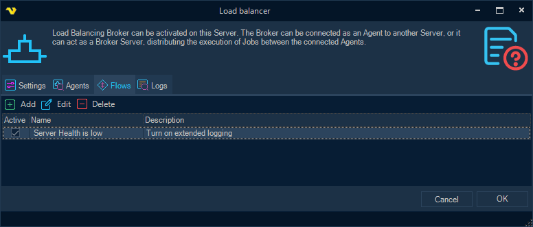
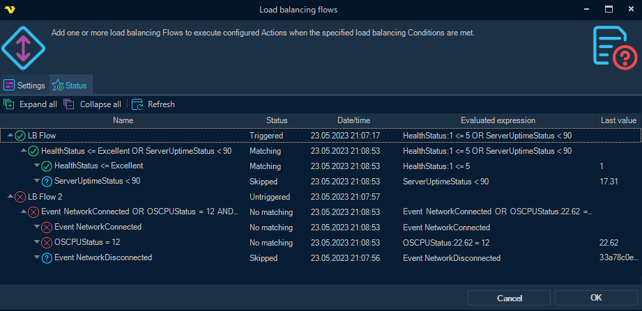

## Load Balancing Flows

:::info Availability

Load Balancing requires VisualCron **11.2.1** or later and a **Pro Subscription** license. See [Load Balancer](load-balancer) for the full feature overview.

:::

Load balancing Flows (**Flows** for short) - allow to perform a set of different Actions depending on the match of certain Load balancing Conditions.

A combination of different Conditions, as well as one or more Actions to be performed when the Conditions match, can be configured for each Flow.
 
Actions in a Flow are performed once the first time the configured Conditions match.
Then an Action can be performed again if a mismatch of the Conditions is detected beforehand (i.e. change of the state of one or another object or service, which resulted in termination of the Condition match), or if a Condition is matched due to the firing of some event in the VisualCron Server (i.e. disconnecting an Agent from the Broker).
 
Load balancing Conditions are configured in the same way as the conditions in the [Event Trigger - Variable](../server/event-trigger-variable) topic.
 
See the [Load balancing Conditions](load-balancing-conditions) topic for information on configuring load balancing Conditions, as well as all supported Conditions.
 
**Supported types of Actions**
 
* _Execute Job_
* _Run Notification_
* _Adjust settings_
* _Start server_
* _Stop server_
 
Currently, the execution of Actions  (except for the actions _Start/Stop server_) is supported on the local Server where Flows are configured and functioning. However, in the case of an Execute Job Action, the specified Job may itself be configured for distributed execution.
Adjust settings Action is reversible, that is, it can be configured so that in case of termination of the Condition match, the previously adjusted settings are reset to their original state.
 
**Configuring and checking the status of Flows at runtime**
 
Flows, together with their Conditions and Actions, can be configured on the ***Flows*** tab of the ***Load balancer*** window, and in the ***Load balancing flows*** window, opened from ***Servers*** -> ***Flows***.
The ***Load balancing flows*** window also has a ***Status*** tab, which shows the runtime status of every Flow condition and updates automatically. Click _Refresh_ to update it by hand.

**Usage notes**
 
Both Conditions and Actions are universal and not necessarily related directly to load balancing or execution distribution.

For example, if there is significant fragmentation in the local Log database, or CPU usage exceeds threshold, the system administrator can be notified accordingly.

Another example is when, due to a large number of simultaneously running jobs, it might be necessary to temporarily block the launch of new Jobs, or put them in a queue.

**Examples**

_Queue new Jobs while the computer is under load_

* Condition: _OS CPU (%)_ is over `90` for `5` minutes
* Action: _Adjust settings_, changing the runtime Job start policy so new Jobs are queued

Because the _Adjust settings_ Action is reversible, configure it to restore the original setting when the Condition stops matching. New Jobs are then held while CPU is high and released automatically once it drops.
 
_Notify an administrator about the Log database_

* Condition: _LogDB fragmentation (%)_ is over `30`
* Action: _Run Notification_, sending to the administrator

See [Load balancing Conditions](load-balancing-conditions) for the full list of Conditions that can be used here.
