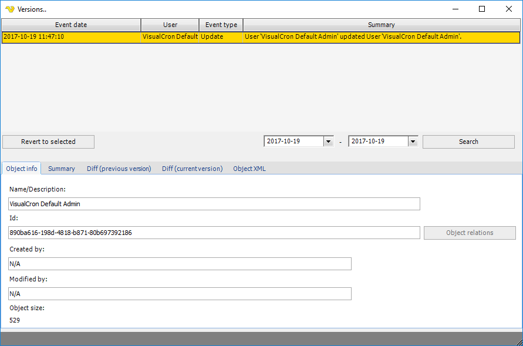

## Versions

The ***Versions..*** window lists the stored versions of one object, shows what changed between versions, and can revert the object to a selected version.

To open it, do one of the following:

- In the ***Audit log*** window, double-click a row, or right-click it and click ***Versions and details***; see [Objects - Audit Log](objects-audit-log)
- Right-click a Job, Task or other object, such as a Connection or Credential, and click ***Versions..***

The upper part lists the stored versions with _Event date_, _User_, _Event type_ and _Summary_. When the window opens, the date range is set to the period that holds versions of the object and the list is filled. To change the period, set the dates and click ***Search***. How long versions are kept is set by the audit log settings in [Settings - Log Settings](../server/settings-log-settings).

Click a row to show the stored object in the tabs below.

### Revert to selected

:::warning

If the object exists, revert overwrites it with the selected version as soon as you confirm. A deleted object can be re-created only while its audit log entries are kept. Revert restores only the object itself, not the objects it refers to. For example, if a reverted Task uses a Credential that no longer exists, the Task may fail until you re-create the Credential and select it in the Task again.

:::

1. Click a row in the version list.
2. Click ***Revert to selected***, or right-click the row and click ***Revert to selected version***.
3. Click ***Yes*** in the ***Revert object*** confirmation.

The object is updated to the selected version, or re-created if it no longer exists. The revert is logged as an add or an update.

### Object info tab

- _Name/Description_: the name of the object
- _Id_: the identifier of the object
- _Created by_ and _Modified by_: who created and last changed the object, with the dates
- _Object size_: the size of the stored object
- ***Object relations***: opens [Objects - Object Relations](object-relations) for the object

### Summary tab

The same text as the _Summary_ column, easier to read when there are many changes.

### Diff (previous version) tab

The property changes between the selected version and the version before it.

### Diff (current version) tab

The property changes between the selected version and the object as it is now.

### Object XML tab

The stored object as XML.
