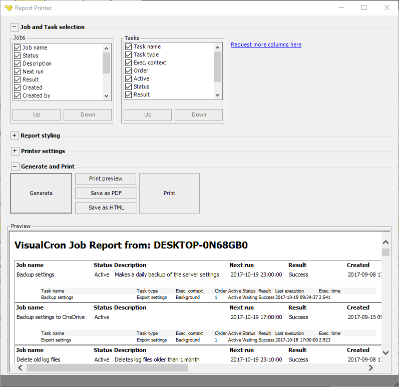

## Report - Print Job Report

There is no Print Job report button in the current Client; reports open from the ***Reports*** tab. Each button on the ***Reports*** tab opens its report in a ***Reports*** window, where you can review, print or copy it. For the reports on the tab, see [Reports](../reports).

### Report window

- The two date fields: where a report covers a period, they set its start and end. By default the last 7 days are shown
- ***Show***: builds the report, and rebuilds it after you change the dates. While the report is being built, the button changes to ***Cancel***
- Theme: the combo box switches the report style between "Dark blue", "Dark grey" and "Light grey"
- ***Print***: prints the report
- ***Copy HTML***: copies the report as HTML to the clipboard
