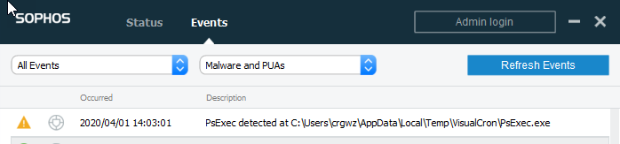
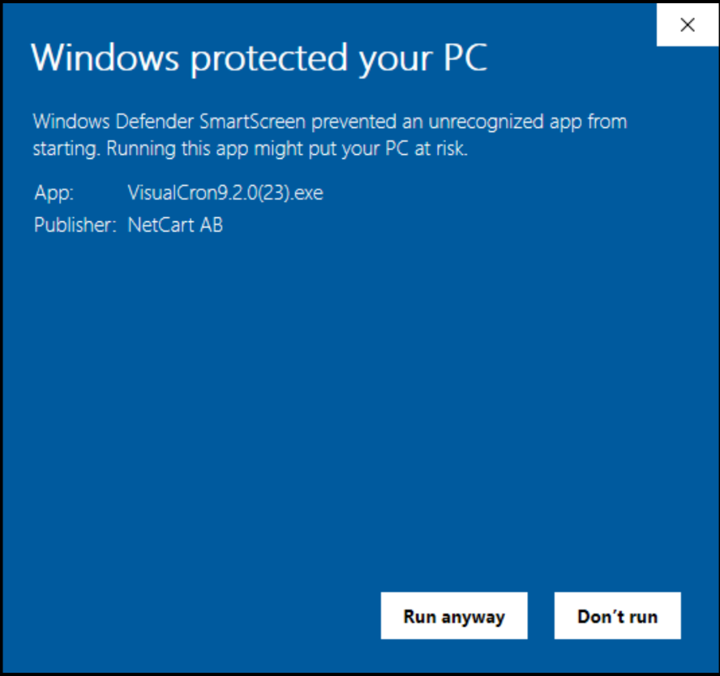

## Download, Install, Upgrade, and Uninstall

This page explains how to install VisualCron with the setup program, what to do right after you install, what happens when you upgrade, and how to uninstall. For silent and scripted installations with the MSI package, see [Remote, Silent, and Customized Installation](remote-silent-customized-installation).

### Before you start

You need:

- A local administrator account on the computer
- .NET Framework 4.8, available from [Microsoft](https://dotnet.microsoft.com/en-us/download/dotnet-framework/net48)
- The setup program, `VisualCron<version>.exe`, from the download page (see [Get VisualCron](get-visualcron.md))

If .NET Framework 4.8 is missing, the setup program offers to open the Microsoft download page.

For the full requirements, see [Requirements](../requirements).

If VisualCron is already installed, back up your settings first, as described in the next section.

### Back up the settings

Before you upgrade, export the Server settings to a file outside the VisualCron installation folder. For the steps, see [Back up before you upgrade](upgrading%20versions#back-up-before-you-upgrade). To go back to the previous version later, see [Return to the previous version](upgrading%20versions#return-to-the-previous-version).

### Install VisualCron

The setup program runs the VisualCron pre-installer, which prepares the computer and then starts the setup wizard. If VisualCron is already installed, the pre-installer first removes the installed version. [Upgrade VisualCron](#upgrade-visualcron) describes what that changes.

To install VisualCron, complete the following steps:

1. Double-click `VisualCron<version>.exe`.

   If Windows Defender SmartScreen shows a warning, see [Windows Defender SmartScreen](#windows-defender-smartscreen).

   The *VisualCron pre-installer* window opens and stops any running Tray Client and Client.

   

2. On the welcome page of the setup wizard, click *Next*.

   

3. On the *License Agreement* page, select *I Agree*.

   

4. Click *Next*.

5. Under *What do you want to install?*, select one of the following:

   - *VisualCron Client and Server*: for the computer that runs your Jobs
   - *VisualCron Client only*: for a computer that only connects to a Server elsewhere

   With *VisualCron Client only*, the VisualCron service is still installed, but disabled. To run the Server on that computer later, set the startup type of the VisualCron service to "Automatic" in Windows *Services*, and then start the service.

   

6. Click *Next*.

7. On the *Select Installation Folder* page, keep the folder in *Folder*, or enter another one.

   The default is "C:\Program Files (x86)\VisualCron" on 64-bit Windows.

   

8. Keep *Everyone* selected.

   With *Just me*, the Start menu shortcuts and the entry in the Windows list of installed apps are created only for the user who installs VisualCron.

9. Click *Next*.

10. On the *Confirm Installation* page, click *Next*.

    

    A page titled *Installing VisualCron*, followed by the version number, shows the progress. The installation can take a few minutes.

    

11. When the wizard reports that the installation is complete, click *Close*.

    Unless you selected *VisualCron Client only*, the pre-installer starts the VisualCron service and the Tray Client. It then asks whether to start the Client.

    

12. Click *Yes*.

    The Client starts if *Start VisualCron Client after install* is selected in the pre-installer window, which is the default. If the Client shows "Do you want to try reconnecting?", wait a minute and click *Yes*. The Server can take a while to start the first time.

    

Before you do anything else, secure the "admin" user, as described in the next section.

### After you install

#### Secure the admin user

:::warning

A new Server has one user, "admin", with an empty password. Until you set a password, anyone who can connect to the Server can sign in as "admin", including users who are signed in to the Server computer itself. This applies however VisualCron was installed: with the setup program, with the MSI package, silently, or on a remote computer. The Server creates "admin" with an empty password again only when no users remain.

:::

Secure "admin" before you allow inbound TCP 16444 from other computers. Connect from a Client on the Server computer itself. After a remote or silent installation, connect from a Client on the Server computer, or from a computer on a network that the firewall already allows.

To secure the admin user, complete the following steps:

1. In the Client, connect to the Server as "admin" with an empty password.
2. Go to _Server_ -> _Main settings_ -> _User permissions_.

   The *Manage user permissions* window opens.

3. On the ***Users*** tab, select "admin".
4. Click *Edit*.

   The *Add/Edit user* window opens.

5. On the ***Credentials*** tab, enter a password in *Password*.
6. Click *OK*.

   The next sign-in as "admin" needs the password.

7. Optional: after you create your own administrator user, delete "admin" with *Delete* on the ***Users*** tab.

For the user settings, see [Main - User Permissions](../client-user-interface/server/main-user-permissions).

#### Firewall

The installer does not create a firewall rule. After you secure "admin", allow inbound TCP 16444 only from the computers that run a Client, as described in [Firewall and network](antivirus-exclusions#firewall-and-network).

#### Tray Client and service start time

Setup registers the Tray Client to start whenever a user signs in to Windows, for all users of the computer. See [VisualCron Tray Client](../using-visualcron/visualcron-tray-client).

The setup program also lengthens the time that Windows waits for a service to start. The change takes effect after the next restart of Windows. The MSI package does not change it.

### Upgrade VisualCron

To upgrade, run the setup program of the new version on the computer. You do not need to uninstall first.

To upgrade VisualCron, complete the following steps:

1. Export your settings, as described in [Back up the settings](#back-up-the-settings).
2. In Windows *Services*, check the startup type of the VisualCron service.

   If it is "Disabled", the computer has *VisualCron Client only*.

3. Double-click the new `VisualCron<version>.exe`.

   The pre-installer shows a message that it will stop the VisualCron service and uninstall the current version, and that your settings will remain.

4. Click *OK*.

   The pre-installer stops the Tray Client, the Client and the VisualCron service, copies the Server settings files to a backup folder, and removes the installed version. The backup folder is named VisualCron followed by the date and time, in the Windows temporary folder of the user who runs the setup program. The *Open backup folder* link opens it.

5. Complete the setup wizard as for a new installation. On the *What do you want to install?* page, select the same option as before.

   The wizard proposes the current installation folder.

6. If the *Run VisualCron Windows service as* window opens, complete these steps:

   This window opens when the VisualCron service ran under a Windows account other than Local System. If you select *Run with the default LocalSystem account*, or close the window, the service runs as Local System.

   1. In *Password*, enter the password of the account shown in *Username*.
   2. Click *OK*.

7. When the pre-installer asks whether to start the Client, click *Yes*.

   The new version is installed, and your settings are kept.

An upgrade keeps:

- Your Server settings: Jobs, Tasks, connections, credentials, users and other objects
- The installation folder
- The logs

An upgrade changes:

- The startup type of the VisualCron service, which is set to "Automatic", and the service is started, unless you selected *VisualCron Client only*
- The account that the service runs as, which is Local System unless you enter the previous account in step 6

:::warning

The setup program starts the VisualCron service as soon as the upgrade is done. On a computer where the service must not run, for example a passive failover cluster node where the cluster controls the service, upgrade with the MSI package instead, and run the sample script in [Upgrade silently](remote-silent-customized-installation#upgrade-silently) with `-NoStart`. Then set the startup type of the VisualCron service back to the value the cluster needs. On a computer with only the Client, select *VisualCron Client only* again; otherwise the service is enabled and started.

:::

### Uninstall VisualCron

To uninstall VisualCron, use one of the following:

- Windows *Settings* -> *Apps* -> *Installed apps*, or *Control Panel* -> *Programs and Features*: select `VisualCron <version>`, and then *Uninstall*
- The Start menu: in the `VisualCron <major version>` folder, select *Uninstall VisualCron*
- The MSI package of the installed version: run "VisualCron.msi" from the custom installation package of that same version, and select the option that starts with *Remove VisualCron*
- A command line, for scripts: see [Uninstall silently](remote-silent-customized-installation#uninstall-silently)

The MSI package of a different version cannot remove the installed version. Running the setup program (.exe) again does not offer to remove VisualCron: it uninstalls the installed version and installs again.

If VisualCron was installed with *Just me*, only the user who installed it sees it in the list of installed apps.

Uninstalling removes the files that the installer installed, the VisualCron service and the Tray Client autostart. It keeps:

- The settings files in the settings folder, by default the settings subfolder of the installation folder
- The log files, and the backup folder with any exported settings files
- Files that VisualCron added to the installation folder while it ran, for example downloaded components and the Web Client folder
- The output cache and the internal log database, by default in "C:\ProgramData\VisualCron\output"
- The registry key "HKLM\Software\V-C", which tells the Server where its settings folder is

If you install VisualCron again on the computer, the Server uses these settings again.

:::warning

The settings folder holds your users, Credentials and connection settings. When you take the computer out of service, delete the installation folder, "C:\ProgramData\VisualCron" and the registry key "HKLM\Software\V-C" after you uninstall.

:::

### Installation troubleshooting

#### Log an MSI installation

If the installation fails with an MSI error, run the MSI package with logging and send the log to support.

:::note

If a different version of VisualCron is installed, `msiexec /i` stops with error 1638 and installs nothing. Uninstall VisualCron first. If the same version is installed, the MSI package opens with the options to repair or remove it instead.

:::

To log an MSI installation, complete the following steps:

1. Download the custom installation package (.zip) for your version, as described in [Get VisualCron](get-visualcron.md).
2. Extract the .zip file to a folder.

   "VisualCron.msi" is in the version folder inside the extracted package.

3. Open Command Prompt as administrator.
4. Run the following command, with your own folders:

   ```cmd
   msiexec /i "<version folder>\VisualCron.msi" /L*V "<log folder>\VisualCron-install.log"
   ```

5. Send the log file to support@visualcron.com.

If the installation with the MSI package succeeds, it behaves like a silent installation: the VisualCron service is not started, it runs as Local System, and the "admin" user has no password. Complete the steps in [After a silent installation](remote-silent-customized-installation#after-a-silent-installation). You can also run the setup program again after you have the log.

#### Antivirus

For the folders, processes and ports to consider on a VisualCron Server, see [Antivirus and Endpoint Protection Exclusions](antivirus-exclusions).

Some antivirus products flag PsExec. The Client writes PsExec to its installation folder only when you use *Install VisualCron*, *Upgrade VisualCron* or *Uninstall VisualCron* in _File_ -> _Servers_ -> _Manage Servers_. See [PsExec](antivirus-exclusions#psexec).



#### Windows Defender SmartScreen

A newly released VisualCron version may not yet have a reputation with Windows Defender SmartScreen, so Windows can show a warning when you start the setup program.

- If the publisher shown is "NetCart AB", the setup program comes from VisualCron. Click *More info*, and then *Run anyway*
- If any other publisher is shown, or no publisher, do not run the file. Download it again from the download page, or contact support@visualcron.com

