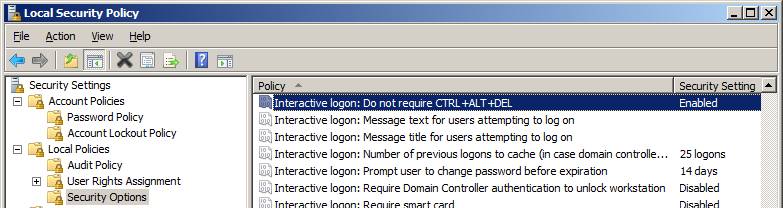
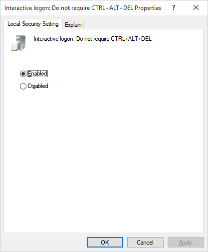
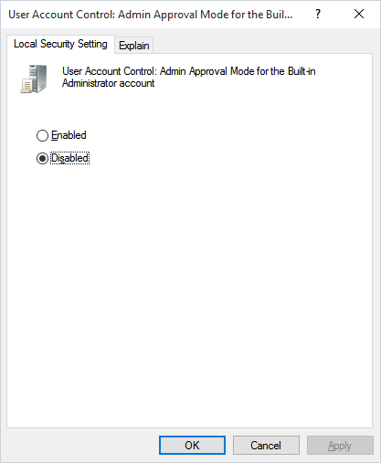

## Archived Security

This page lists two Windows Local Security Policy settings for interactive logon through the VisualCron Credential Provider. VisualCron uses the Credential Provider when a Task logs on a user to run in the foreground. Check these settings on the Server computer if interactive logon does not work.

### Interactive logon

Both settings are in _Local Policies_ -> _Security Options_ of the Local Security Policy console.

#### Do not require CTRL+ALT+DEL

:::warning

With this policy enabled, users no longer press CTRL+ALT+DEL before they log on, so the logon screen is no longer reached through that trusted key sequence. Enable it only on computers that need interactive logon through VisualCron. The default value depends on the Windows version and on domain membership, so check the current value first.

:::

The Credential Provider cannot log on a user when Windows requires CTRL+ALT+DEL before logon. To allow the Credential Provider to log on, complete the following steps:

1. Open _Administrative Tools_ -> _Local Security Policy_.
2. Go to _Local Policies_ -> _Security Options_.
3. Set _Interactive logon: Do not require CTRL+ALT+DEL_ to _Enabled_.

The policy now shows _Enabled_ in _Security Options_.

#### User Account Control: Admin Approval Mode for the Built-in Administrator account

:::warning

With this policy disabled, the built-in Administrator account runs every program with full administrative rights, without a prompt. Change it only if interactive logon through VisualCron does not work without it.

:::

This setting may be needed for VisualCron to communicate with the Credential Provider. To disable it, complete the following steps:

1. Open _Administrative Tools_ -> _Local Security Policy_.
2. Go to _Local Policies_ -> _Security Options_.
3. Set _User Account Control: Admin Approval Mode for the Built-in Administrator account_ to _Disabled_.
4. Restart the computer.

After the restart, the built-in Administrator account no longer uses Admin Approval Mode.
