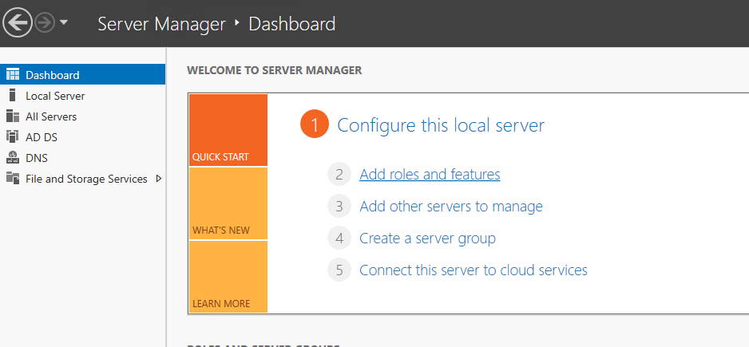
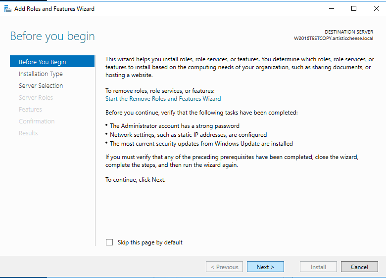
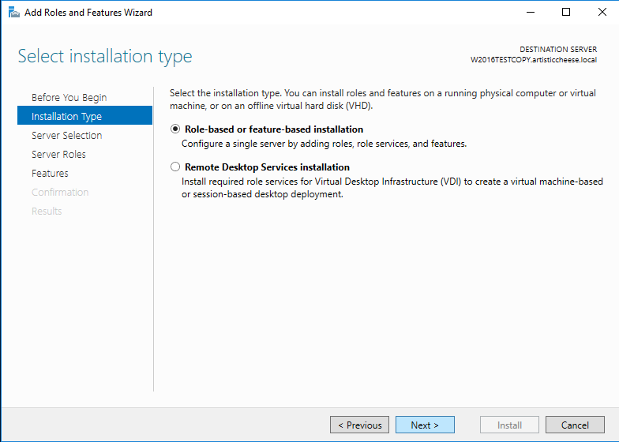
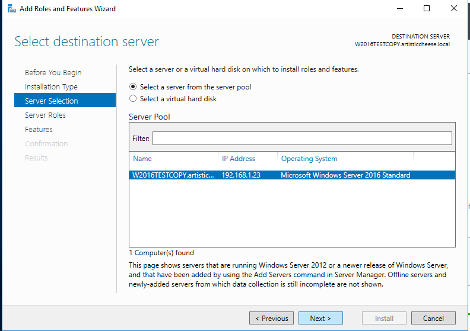
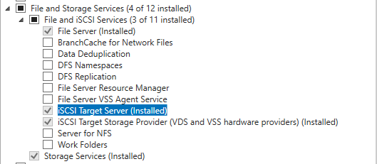
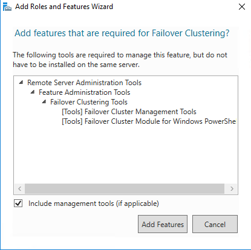

## Configure roles and features on the domain and storage server

This is Part 1, step 1 of 5 in [Install the Windows failover cluster](installing-windows-failover-cluster). In this step you add the iSCSI Target Server role service, which hosts the shared disks, to the domain and storage server. You can also add the Failover Clustering feature, to manage the cluster from this server. This server must already run Active Directory Domain Services and DNS.

### Select the roles

To select the roles, complete the following steps:

1. Sign in to the domain and storage server.
2. In *Server Manager* -> *Dashboard*, click *Add roles and features*. The *Add Roles and Features Wizard* opens on *Before you begin*.

   

   

3. Click *Next*. The *Select installation type* page opens.
4. Select *Role-based or feature-based installation*.

   

5. Click *Next*. The *Select destination server* page opens.
6. Select the server you are signed in to.

   

7. Click *Next*. The *Select server roles* page opens.
8. Under *File and Storage Services* -> *File and iSCSI Services*, select *iSCSI Target Server*. The example server also has *File Server* and *iSCSI Target Storage Provider (VDS and VSS hardware providers)* installed; this guide does not need them.

   

9. Click *Next*. The *Select features* page opens.

### Add the feature and install

The Failover Clustering feature is needed only on the cluster nodes. On this server it is optional: add it if you want to run *Failover Cluster Manager* here. If you do not, start at step 3.

To add the feature and install, complete the following steps:

1. Optional: select *Failover Clustering*. If its tools are not installed yet, the *Add features that are required for Failover Clustering?* window opens and lists them.

   

2. Click *Add Features*.
3. Click *Next*. The *Confirm installation selections* page opens.
4. Check that every role and feature you selected is listed.
5. Click *Install*. The roles and features are installed.
6. When the installation is complete, click *Close*.
7. If the wizard says that a restart is needed, restart the server.

Result: The domain and storage server runs the iSCSI Target Server and, if you added it, the Failover Clustering feature.

:::note

The domain and storage server is not a cluster node. Do not add it to the cluster in [Part 1, step 5](create-the-failover-cluster).

:::

### Next step

[Configure roles and features on the nodes](configure-roles-nodes)
