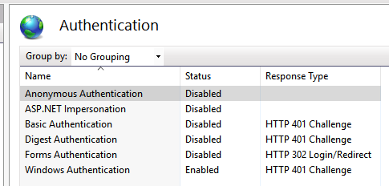

## Enable Windows Authentication / Active Directory Logon

This page explains how to let users log on to the VisualCron Web Client with their Windows (Active Directory) account. It applies to the Web Client only. To use Active Directory logon in the Client, see [Settings - Users/Logon](../client-user-interface/server/settings-users-logon) and [Servers - Manage Servers](../client-user-interface/file/manage-servers).

### Before you start

To prepare the Server that the Web Client connects to, complete the following steps:

1. Go to _Server_ -> _Main settings_ -> _Settings_ -> **_Users/Logon_** tab.
2. Check _Allow Active Directory Logon_.
3. Enter the _AD Server_. See [Settings - Users/Logon](../client-user-interface/server/settings-users-logon).
4. Click _Apply settings_.
5. In _Server_ -> _Main settings_ -> _User permissions_, add the Active Directory users or groups that may log on. See [Main - User Permissions](../client-user-interface/server/main-user-permissions).
6. Make sure that the Web Client is installed (see [Installation of Web Client](installation-of-web-client)) and that the _Windows Authentication_ role service of IIS is installed (see [Prepare Windows](installation-of-web-client#prepare-windows)).

### Turn on Windows authentication for the Web Client

If the Web Client runs on a computer other than the Server, the VisualCron service on that computer is normally stopped (see [Install the Web Client on a computer other than the Server](installation-of-web-client#install-the-web-client-on-a-computer-other-than-the-server)). Start it in Windows Services before you begin, and stop it again when you are done.

To turn on Windows authentication, complete the following steps:

1. On the computer that hosts the Web Client, right-click "VisualCronClient.exe" in the VisualCron installation folder (by default "C:\Program Files (x86)\VisualCron") and select _Run as administrator_.
2. Connect to the local Server.
3. Go to _Server_ -> _Main settings_ -> _Settings_ -> **_Web Client_** tab.
4. In the _IIS_ or _IIS Express_ box where the Web Client is installed, click _Enable_. _Windows authentication_ changes to "Yes" and the button changes to _Disable_.
5. For IIS, open IIS Manager and select the "VisualCronWebClient" site.
6. Open _Authentication_.
7. Make sure that _Windows Authentication_ is "Enabled" and that _Anonymous Authentication_ and the other methods are "Disabled". Change any that differ.

   

For IIS Express, check that _Windows authentication_ shows "Yes" on the **_Web Client_** tab.

:::note

When you upgrade VisualCron, the VisualCron service replaces the Web Client files, including "web.config", at its next start. After an upgrade, check _Windows authentication_ on the **_Web Client_** tab and click _Enable_ again if it shows "No".

:::
