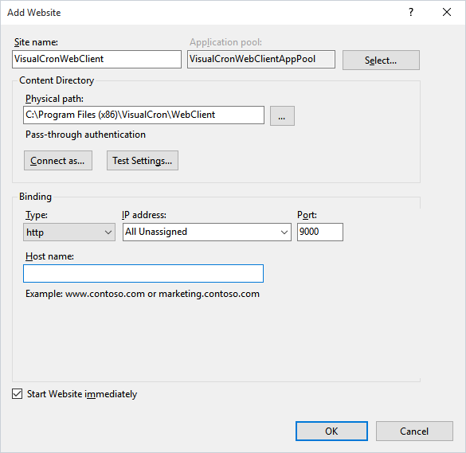

## Installation of Web Client

This page explains how to prepare Windows for the VisualCron Web Client, how to install the Web Client from the Client or manually in IIS, and how to fix common installation problems. To learn what the Web Client does, see [VisualCron Web Client](visualcron-web-client).

### Requirements

- A Windows version that VisualCron supports, with .NET Framework 4.8 (see [Requirements](../requirements))
- VisualCron installed on the computer that hosts the Web Client, normally the Server computer
- Microsoft IIS, or IIS Express 8.0 or later, on that computer
- For IIS, the ASP.NET 4.x role service (see [Prepare Windows](#prepare-windows))
- Administrator rights on that computer
- A local connection from the Client to the Server, to install the Web Client from the Client

### Prepare Windows

Before you install the Web Client in IIS, install IIS with ASP.NET:

- On Windows Server, add the _Web Server (IIS)_ role in _Server Manager_ -> _Manage_ -> _Add Roles and Features_. Under _Application Development_, select the ASP.NET 4.x role service. Its version number depends on your Windows version.
- On desktop Windows, open _Turn Windows features on or off_ and turn on _Internet Information Services_ with its ASP.NET 4.x feature.

If users will log on to the Web Client with Windows authentication, also install the _Windows Authentication_ role service, under _Security_.

### Install the Web Client from the Client

The Web Client runs as a website named "VisualCronWebClient" in IIS or IIS Express. You install it from the **_Web Client_** tab of the Server settings. The tab checks the web servers on the computer where the Client runs, so run the Client on the Server computer and connect to the Server locally. If IIS is already installed on the computer, use IIS.

To install the Web Client from the Client:

1. If you use IIS, prepare Windows first (see [Prepare Windows](#prepare-windows)).
2. Right-click "VisualCronClient.exe" in the VisualCron installation folder (by default "C:\Program Files (x86)\VisualCron") and select _Run as administrator_.
3. Connect to the local Server.
4. Go to _Server_ -> _Main settings_ -> _Settings_ -> **_Web Client_** tab.
5. Wait until the _IIS_ and _IIS Express_ boxes become available. The Client checks the installed web servers first.
6. In the box for your web server, enter the _Port_. The default is "9000".
7. Click _Install_. When the installation is done, VisualCron shows "Installed!".
8. Click the _Link_ to open the Web Client in your browser.
9. In the Web Client, click _Manage servers_, add a server connection to the Server, and connect with a VisualCron user name and password, the same users as in the Client (see [Main - User Permissions](../client-user-interface/server/main-user-permissions)). To log on with Windows accounts instead, see [Enable Windows Authentication / Active Directory Logon](enable-windows-authentication).

If IIS Express 8.0 or later is not installed when you click _Install_ in the _IIS Express_ box, VisualCron tries to install it. If it cannot, it shows a message. In some cases the message offers to open the IIS Express download page: click _OK_ to open it in your browser, install IIS Express, and then click _Install_ again. In the _IIS_ box, VisualCron likewise tries to install IIS when it is not installed, so install IIS with ASP.NET yourself first (see [Prepare Windows](#prepare-windows)).

_Server_ -> _Main settings_ -> _Settings_ -> **_Web Client_** tab

#### Fields and buttons on the Web Client tab

The _IIS_ box and the _IIS Express_ box show:

- _IIS installed_: whether that web server is installed, and its version
- _Web Client installed_: whether the Web Client is installed in that web server
- _Link_: the address of the Web Client; click it to open the Web Client in your browser
- _Source path_: the folder the website runs from, normally the "WebClient" folder in the VisualCron installation folder; click it to open the folder
- _Windows authentication_: "Yes" or "No"
- _Port_: the port of the website

| Button | What it does |
|---|---|
| _Install_ | Installs the Web Client in that web server. Unavailable while the Web Client is installed there |
| _Uninstall_ | Removes the Web Client website from that web server and shows "Site deleted". If removing fails, it shows "Site deletion failed" |
| _Enable_ / _Disable_ | Turns Windows authentication on or off for the Web Client website. Available after the Web Client is installed there. See [Enable Windows Authentication / Active Directory Logon](enable-windows-authentication) |

#### Change the port

You cannot change the port of an installed Web Client on the **_Web Client_** tab. Use one of these options:

- For IIS, change the website's binding in IIS Manager
- Click _Uninstall_, enter the new _Port_, and click _Install_ again

### Install the Web Client manually

You can also create the Web Client website yourself in IIS Manager. VisualCron must be installed on the same computer, because the website runs from the "WebClient" folder of the VisualCron installation. Prepare Windows first (see [Prepare Windows](#prepare-windows)).

To install the Web Client manually:

1. Install VisualCron on the computer with the installation type _VisualCron Client and Server_.
2. Start the VisualCron service (named "VisualCron" in Windows Services) once. At its first start after an installation or upgrade, the service unpacks the Web Client files into the "WebClient" folder of the installation folder. It replaces the contents of that folder, including "web.config", and keeps only the Web Client database, so changes you make to files in that folder are lost at each upgrade.
3. In IIS Manager, add an application pool named "VisualCronWebClientAppPool", with .NET CLR version "v4.0" and the "Integrated" pipeline mode.

   

4. Right-click _Sites_ and select _Add Website_.

   

5. Set the site name to "VisualCronWebClient".
6. Select "VisualCronWebClientAppPool" as the application pool.
7. Set the physical path to the "WebClient" folder in the VisualCron installation folder, by default "C:\Program Files (x86)\VisualCron\WebClient".
8. Enter a port. The Client uses "9000" by default.
9. Click _OK_ to save the website.
10. To let users log on with Windows authentication, follow [Enable Windows Authentication / Active Directory Logon](enable-windows-authentication).
11. In your browser, go to `http://localhost:<port>` to open the Web Client.

### Install the Web Client on a computer other than the Server

To run the Web Client on a computer other than the Server, complete the following steps:

1. Install VisualCron on the IIS computer with the installation type _VisualCron Client and Server_.
2. Install the Web Client there as described in [Install the Web Client from the Client](#install-the-web-client-from-the-client).
3. In Windows Services, stop the VisualCron service on that computer.
4. Set the service's _Startup type_ to _Manual_.
5. In the Web Client, add a server connection to the Server you want to manage. That Server must accept remote connections: _Only allow local connections_ must be cleared (see [Settings - Users/Logon](../client-user-interface/server/settings-users-logon)), and the Server port must be allowed through Windows Firewall (see [Port and firewall](visualcron-server#port-and-firewall)).

After you upgrade VisualCron on the IIS computer, start the VisualCron service there once, so that it updates the Web Client files, and then stop it again. Then check in Windows Services that the service's _Startup type_ is still _Manual_. For a custom installation package, contact VisualCron Support.

### Windows authentication

Users can log on to the Web Client with their Windows account when the Server allows Active Directory logon (_Allow Active Directory Logon_ on the **_Users/Logon_** tab of _Server_ -> _Main settings_ -> _Settings_), the users or groups are added in _User permissions_, and Windows authentication is turned on for the Web Client website. For the full procedure, see [Enable Windows Authentication / Active Directory Logon](enable-windows-authentication).

### Troubleshooting

#### Installation fails when you click Install

Close the Client. Then right-click "VisualCronClient.exe", select _Run as administrator_, and try again.

#### HTTP Error 403.14 - Forbidden

Make sure that IIS has the ASP.NET 4.x role service (see [Prepare Windows](#prepare-windows)). Restart the computer if Windows asks you to.

#### The Web Client does not display correctly

Use Google Chrome or Mozilla Firefox.

#### Other computers cannot open the Web Client

Check that Windows Firewall on the computer that hosts the Web Client allows incoming connections on the website's port. From another computer, use the host computer's name or IP address instead of "localhost".

#### Active Directory logon does not work

Check every step in [Enable Windows Authentication / Active Directory Logon](enable-windows-authentication), in particular the authentication settings of the Web Client website in IIS Manager. Also check the server connection in the Web Client (step 9 of [Install the Web Client from the Client](#install-the-web-client-from-the-client)).