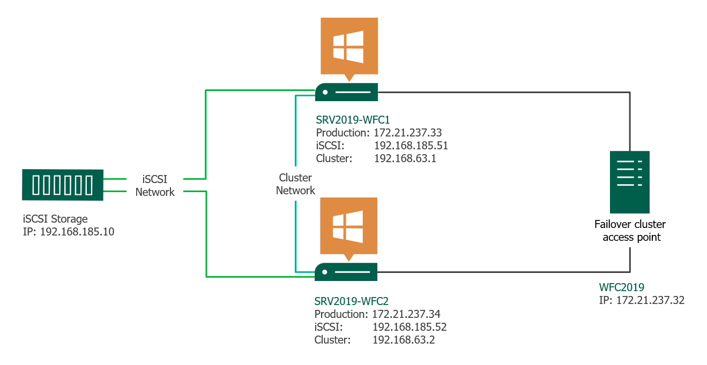

## Install the Windows failover cluster

This is Part 1 of [Using VisualCron in a failover cluster](using-visualcron-in-a-clustered-environment). In this part you prepare the Windows servers, create the shared iSCSI storage and create the failover cluster. In Part 2 you [install and set up VisualCron on the failover cluster](install-and-setup-visualcron-on-failover-cluster).

The steps and screenshots in this guide were taken on Windows Server 2016. Labels and menu paths can differ on other Windows Server versions. For the version you use, see the Microsoft overview linked under Requirements.

### Example topology

The example uses the following machines:

- A domain and storage server, which runs Active Directory and DNS and hosts the iSCSI target with the shared disks
- Two cluster nodes, either of which can run VisualCron, one at a time

The diagram draws the iSCSI storage as a separate device. In this guide the domain and storage server hosts it. The failover cluster access point in the diagram is the cluster name and IP address that you create in [Part 1, step 5](create-the-failover-cluster).

This guide uses two nodes. The VisualCron role can fail over only to a node where VisualCron is installed as in [Part 2, step 4](install-visualcron-on-both-nodes).

### Requirements

Check the following before you start:

- A domain and storage server running Active Directory Domain Services and DNS
- Two servers to use as cluster nodes, with the same Windows Server version, edition and updates
- Static IP addresses on the nodes, which are recommended
- A domain account that is a local administrator on every node and can create computer objects in Active Directory, for the cluster name
- Shared storage that every node can reach (Part 1, steps 3 and 4)

For the complete list of requirements, start from [Microsoft's failover clustering overview](https://learn.microsoft.com/en-us/windows-server/failover-clustering/failover-clustering-overview).

:::warning

This example uses a single domain and storage server. If that server stops, the cluster loses its shared disks and VisualCron stops running Jobs. For production, use highly available storage and domain controllers.

:::

### Steps

1. [Configure roles and features on the domain and storage server](configure-roles-fcap)
2. [Configure roles and features on the nodes](configure-roles-nodes)
3. [Create an iSCSI virtual disk for the cluster](create-iscsi-network-drive)
4. [Connect the nodes to the iSCSI disk](connecting-to-iscsi-network-drives)
5. [Create the failover cluster](create-the-failover-cluster)

### Next step

[Configure roles and features on the domain and storage server](configure-roles-fcap)
