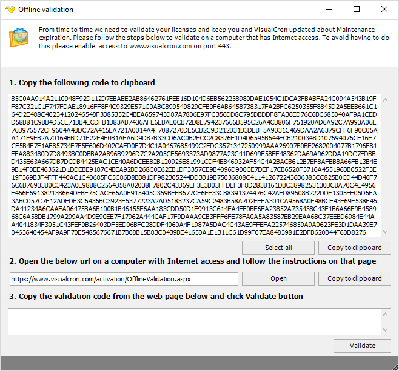

## License validation

VisualCron checks your license online with the VisualCron website, to confirm that the activation code is valid and to update the maintenance or subscription expiration. This page explains which computers need Internet access, what to do when a check finds a problem, and how to validate offline.

### How VisualCron validates the license

The Client and the Server check the license online with the VisualCron website, regularly:

* The Client checks from the computer where it runs
* The Server checks from the Server computer, through the proxy on the ***Proxy*** tab of the Server settings (see [Settings - Proxy](../client-user-interface/server/settings-proxy))

If the Server computer cannot reach the VisualCron website, the Server's check does not change the license.

To check at once, click *Server* -> *Information* -> *License* -> *Refresh license data*. For the expiration date that the checks update, see [Maintenance and subscription expiration](maintenance-expiration).

### Allow access to the VisualCron website

Allow the Server computer, and each computer where a Client runs, to reach [www.visualcron.com](https://www.visualcron.com) on port 443.

### When a check finds a problem

When the Client's check finds a problem, the *Server license problem* window opens. It shows the problem and the action taken. After you fix the problem, click *Update status* to check again.

* The activation code is in use on another Server: deactivate it on the other Server (see [Move a license](move-a-license)), or contact [VisualCron support](https://www.visualcron.com/Contact.aspx)
* The installed version is not covered by the license: renew the maintenance or subscription with *Renew your license*, or install a version that the license covers with *Downgrade to an older version*. Until then, the Client may disconnect from the Server
* The subscription has expired: Jobs no longer run. Renew the subscription with *Renew your license* (see [Maintenance and subscription expiration](maintenance-expiration))
* The activation code is not found

:::warning

If VisualCron reports that the activation code is not found, the Server removes its activation and returns to trial. When the trial period has ended, the Server stops running Jobs. Check the activation code on the My licenses page and activate the Server again (see [License and activation](license-and-activation)), or contact [VisualCron support](https://www.visualcron.com/Contact.aspx).

:::

### Validate offline

If the Client cannot reach the VisualCron website when a validation is overdue, the *Offline validation* window opens. The window stays open until you validate.

To validate offline, complete the following steps:

1. Under *1. Copy the following code to clipboard*, click *Copy to clipboard*, and paste the code into a file that you can take to a computer with Internet access, for example a text file.
2. Under *2. Open the below url on a computer with Internet access and follow the instructions on that page*, click *Copy to clipboard*, and paste the address into the same file. You can also type the address as the window shows it.
3. On a computer with Internet access, open the address in a browser.
4. Follow the instructions on the web page to get the validation code.
5. In the Client, paste the validation code into the box under *3. Copy the validation code from the web page below and click Validate button*.
6. Click *Validate*.

When the validation succeeds, the Client shows "Thank you for validating - information has been updated!". If the validation code reports a problem, the window closes and the Client applies the result, as described in [When a check finds a problem](#when-a-check-finds-a-problem).

