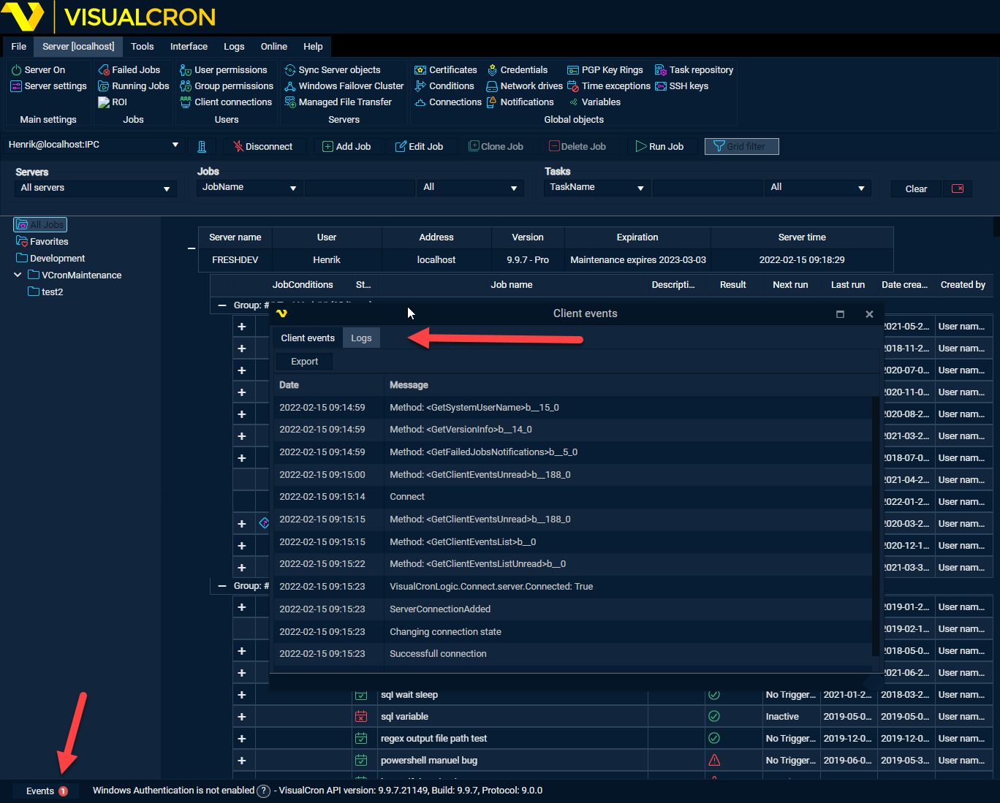

## VisualCron Web Client

The VisualCron Web Client is a simplified version of the Client that runs in a web browser, so you can work with a VisualCron Server from any device without installing the Client. It shows the progress of Jobs and Tasks in real time. Its toolbar has buttons to add, edit, clone, delete and run Jobs, and you can manage your server connections from it. The Web Client has been available since VisualCron 7.6.5.

The Web Client is a website that runs in Microsoft IIS or IIS Express on a computer where VisualCron is installed, normally the Server computer. To set it up, see [Installation of Web Client](installation-of-web-client). To log on with a Windows (Active Directory) account, see [Enable Windows Authentication / Active Directory Logon](enable-windows-authentication).

**Trouble connecting?**

If the Web client gets stuck connecting you can open the Client->Events->Logs and send a screenshot to Support

### Next steps

- [Install the Web Client and troubleshoot the installation](installation-of-web-client)
- [Log on to the Web Client with Windows authentication](enable-windows-authentication)